# 实物制作与成品记录

本页集中展示全部 13 张照片、4 段视频。文件名按画面内容命名：`finished-*` 为成品展示，`build-*` 为制作与测试；排列按主题组织，不代表拍摄先后。原始照片、视频仅重命名，未裁剪、调色或重新编码。

四段播放器均使用上传至 GitHub 附件存储的 H.264／AAC 播放版本，点击即可播放；默认静音，点击扬声器按钮可开启声音。下载链接保留原始 HEVC／AAC 视频，可使用支持 HEVC 的播放器打开。

## 成品展示

四个角度展示整机比例、格栅层次、暖光，以及唱盘、唱臂与控制面板布局。本组成品素材中未安装防尘盖。

**正前上方全景**

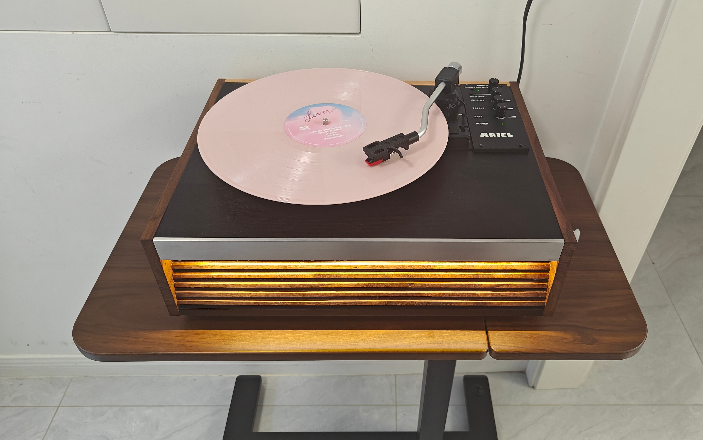

**低角度正面**

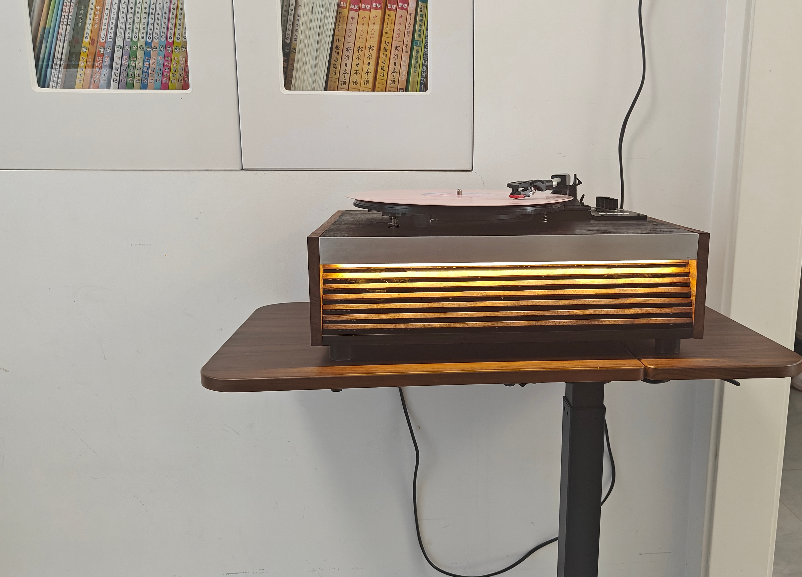

**斜前方**

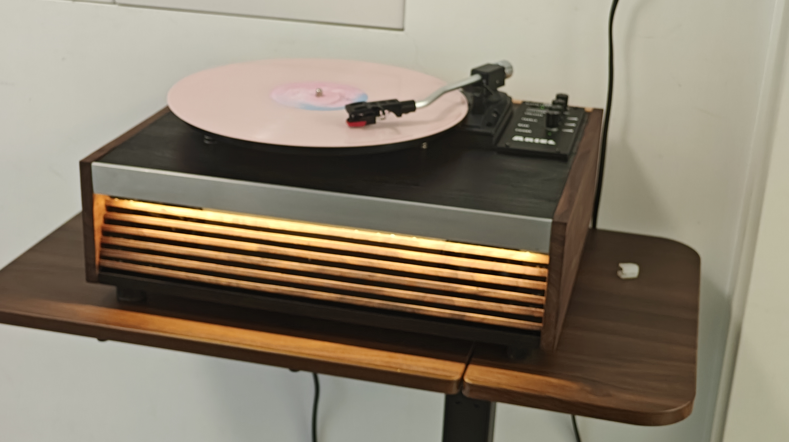

**俯视**

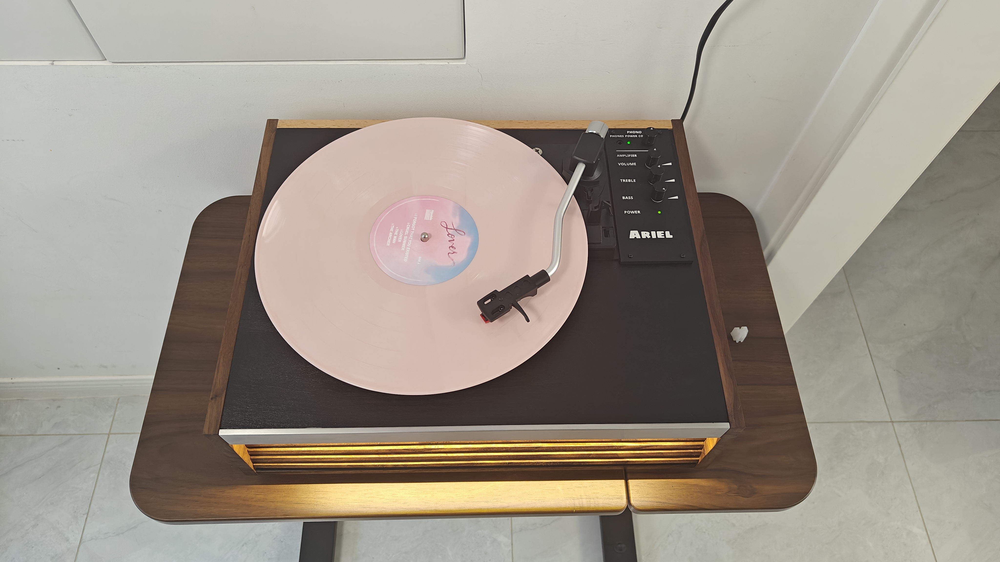

### 成品演示（约 11 秒）

从正面向上移动，展示旋转唱片与暖光格栅。

https://github.com/user-attachments/assets/8cd31f62-5ff7-47e6-9cb5-67212d5645ef

[下载原始 MP4](finished-playing.mp4)

## 制作与测试

**木板备料**

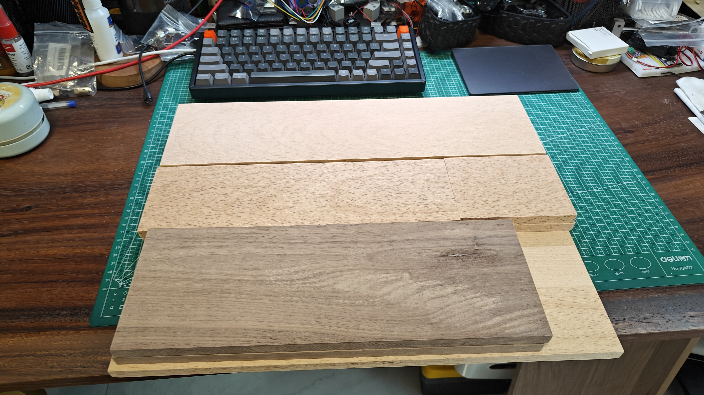

**台面划线与唱片尺寸比对**

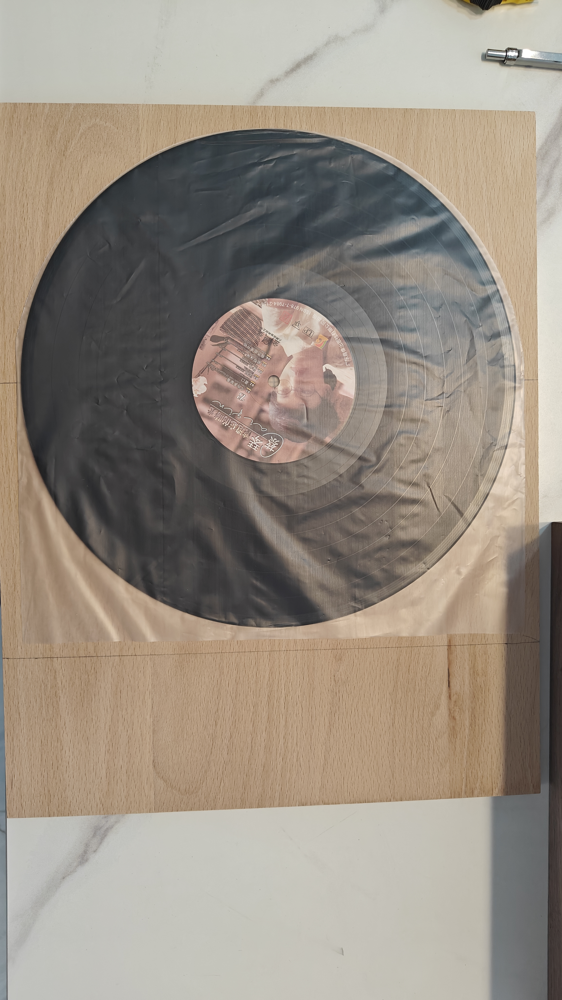

**手锯加工**

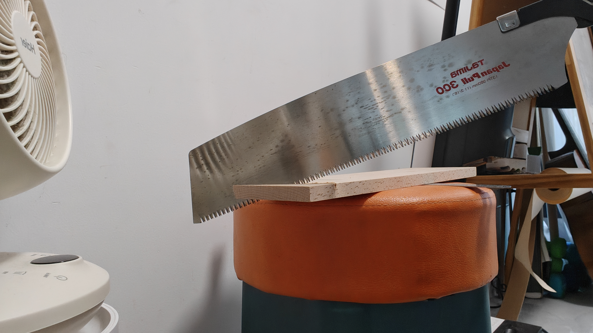

**台面黑色涂装**

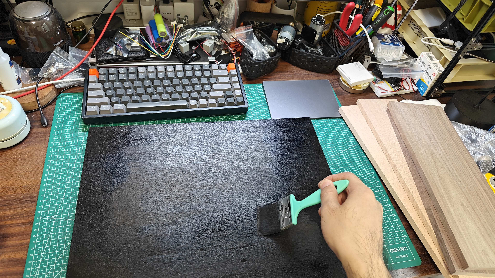

**内部音腔与布线**

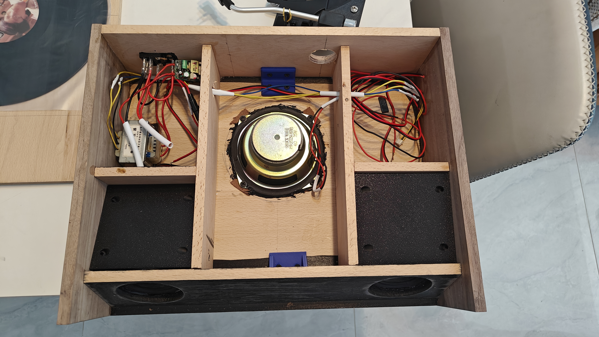

**机芯弹簧近照**

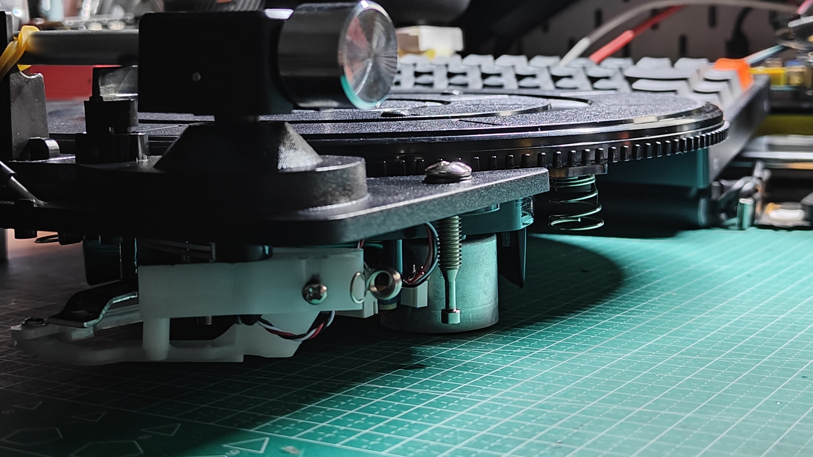

**格栅夹持定位**

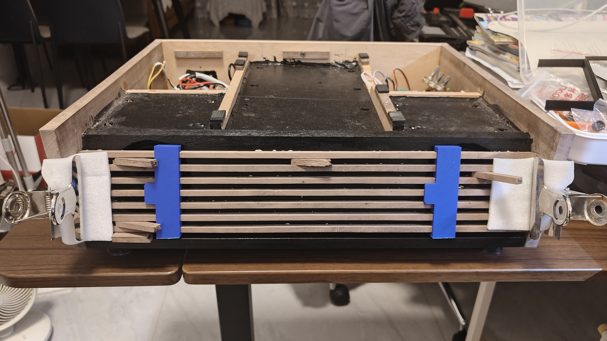

**格栅表面处理**

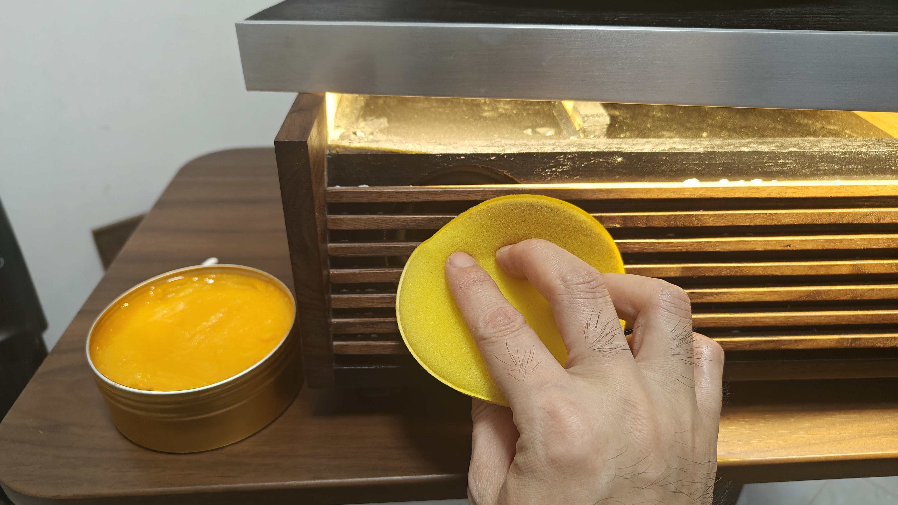

**机芯工作台装配**

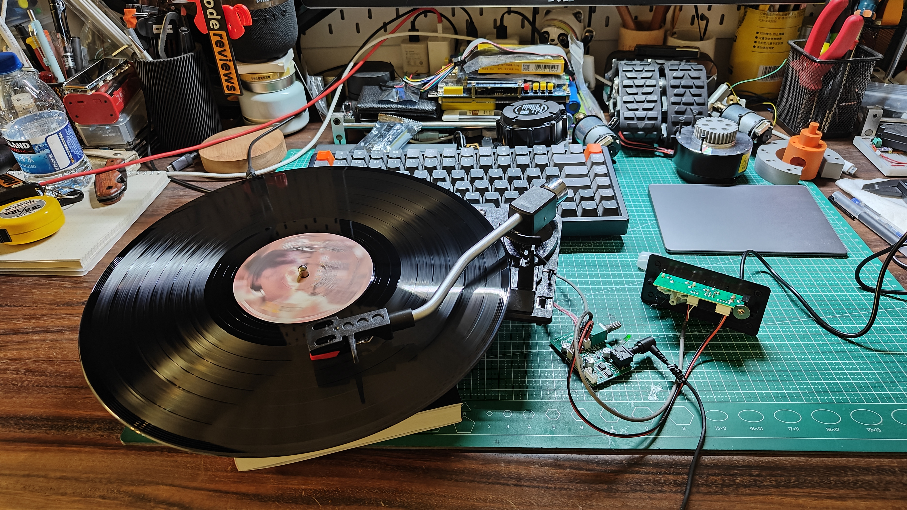

## 制作过程视频

### 黑色唱片测试（约 20 秒）

未完成涂装的台面上进行唱片运行测试。

https://github.com/user-attachments/assets/6d4ae5aa-47e9-449b-a401-17b22107f13c

[下载原始 MP4](build-black-record-test.mp4)

### 控制旋钮测试（约 23 秒）

粉色唱片运行中操作控制面板旋钮。

https://github.com/user-attachments/assets/c1b58fca-b611-4cc4-90f3-96065e823c62

[下载原始 MP4](build-controls-test.mp4)

### 唱臂操作（约 45 秒）

唱臂操作、旋钮调节及唱片运行近景。

https://github.com/user-attachments/assets/399030c0-71a6-472b-919b-bf7628a41d48

[下载原始 MP4](build-tonearm-operation.mp4)

[返回项目 README](../README.md)
