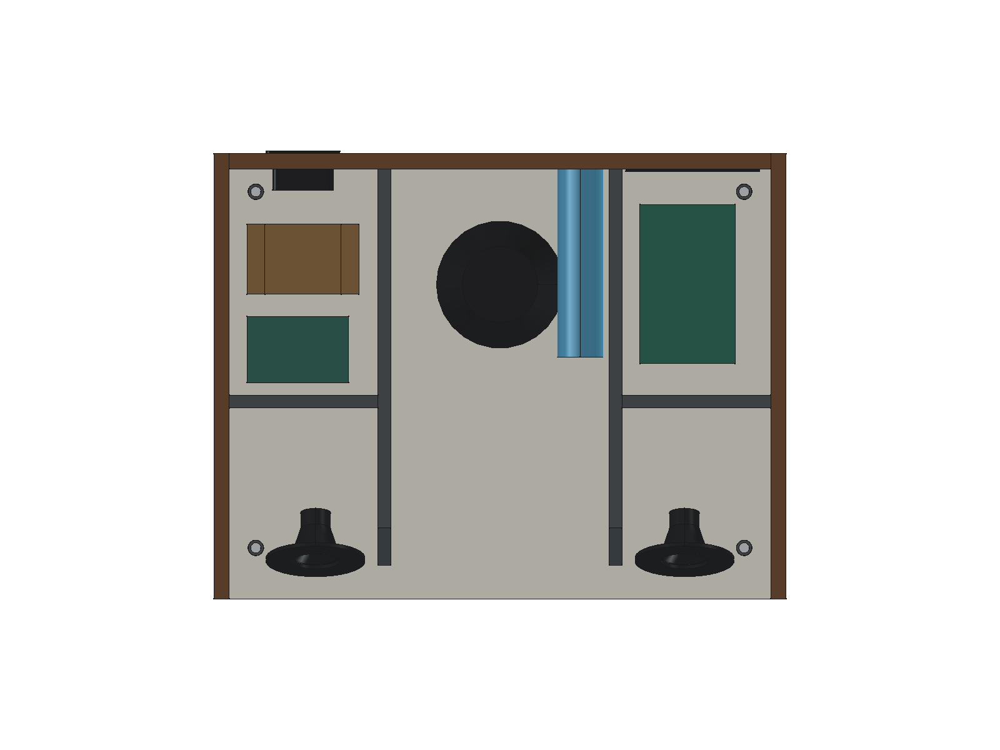
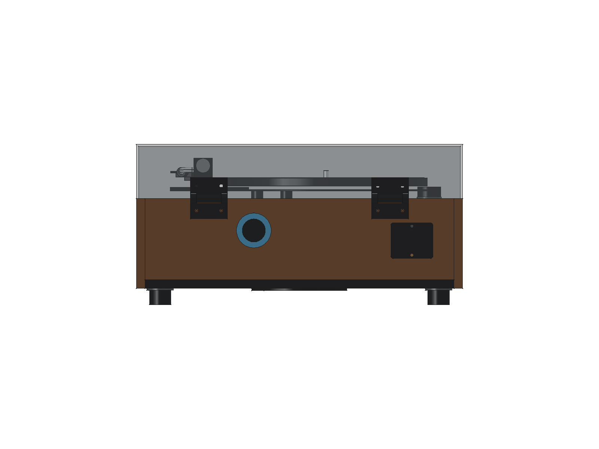

# SC-2103 三音腔布局

文档更新：2026-09-25；模型版本：v0.11-10x6-grille-slats。用户确认扬声器来自 Shockwave SC-2103，原低音箱、卫星箱和倒相管均已遗失，授权按唱机外廓重新设计。该版交付空间方案及可换管试验结构，尚未完成声学调谐或加工放行。

## 布置与尺寸

外廓调整为 450 × 350 × 210.7 mm。坐标原点为左前方桌面，X 向右、Y 向后、Z 向上，单位均为 mm。

| 项目 | 当前布置 |
|---|---|
| 左右全频单元 | 口端 Ø78、总高 40；中心 X=80 / 370、Z=84.5，朝前安装于后倾 18° 的障板 |
| 后排低音 | 口端 Ø132、总高 65；中心 X=225、Y=247，安装面 Z=22.5，朝下；最低点距桌面 19.5 |
| 中央低音腔 | 净宽 172，X=139–311；从斜面障板内侧延伸至后板内面 Y=338；底面 Z=34.5、顶面 Z=124.5 |
| 左右全频腔 | 各净宽 117；斜面障板至 Y=150，Z=34.5–124.5；相互及与低音腔不通气，先采用密闭试装 |
| 分隔结构 | 两道 10 mm 全深隔板位于 X=129–139 / 311–321；左右后隔板 Y=150–160；10 mm 声腔顶板 Z=124.5–134.5 |
| 左后变压器 | 固定耳保守包络 X=26–114、Y=239.5–294.5、Z=34.5–84.5 |
| 左侧备用电子区 | X=26–106、Y=170–222、Z=44.5–61.5；在机芯核对版中不代表另需唱放 |
| 右后功放 | 含散热片 125 × 75 × 45，平放旋转 90°；X=335–410、Y=185–310、Z=44.5–89.5 |
| 后接口占位 | 移至右侧 X=324–429，与中央低音倒相管分开；实际接口开孔和插拔空间未设计 |

斜障板法向厚度为 10 mm，沿 Y 的厚度约 10.515 mm；对应隔板下前角 Y≈26.515、上前角 Y≈55.758。前缘按该精确轮廓闭合，不能把接缝坐标取整。整数备料与修切说明见[图册](drawing-pack.md)。

前沿 T 型铝条的安装台阶位于斜障板前方，不进入三音腔密封边界；上表中的 10 mm 顶板厚度适用于音腔封闭部分。前伸部分 Y=5.2..30.2 加工 5.7 mm 深台阶后余厚 4.3 mm，三腔几何容积不受前缘台阶影响，详见[饰条安装说明](../references/fascia/README.md)。顶板另有三个 Ø16 × 3 mm 顶面沉台，与浮动台面底面的同尺寸沉台共同定位 Ø16 × 8 mm 弹性支承；沉台不贯穿音腔，尺寸与隔振效果仍为安装假设。

后部承托梁分成左右两段，中央利用音腔顶板承托原有后支点。低音腔顶板为通用机芯轴承增加封闭避让杯，外半径 14、内半径 12、底面 Z=106.5、内底面 Z=108.5。它只适用于基线的通用轴承占位，不能作为当前弯臂机芯的适配证据。

## 体积与计算口径

以下由 [保存模型验证报告](../cad/validation.json)计算，并非根据外廓长宽高直接估计。

| 音腔 | 几何毛容积（已扣封闭避让杯） | 扣除安装包络和倒相管后的保守净容积 |
|---|---:|---:|
| 中央低音 | 4.584 L | 4.041 L |
| 左全频 | 1.146 L | 1.112 L |
| 右全频 | 1.146 L | 1.112 L |

验证时只临时封住设计的单元开孔和倒相口，从保存的板件中求出三个互不连通的封闭空间。净容积扣除所有已建模部件在腔内的占用；扬声器使用实心圆柱安装包络，变压器使用包含固定耳上方空间的完整包络，倒相管扣除整个外廓（包括管内空气）。重叠占用通过布尔差集只扣一次，避免漏扣移入音腔的电子件，也避免把空心盆架当作几乎不占容积的部件。未计尚未建模的吸音材料、支柱、密封件和线缆；实物轮廓及这些附加占用仍会改变有效容积。脚座穿板孔由保存的脚垫／固定座实体理想贴合封闭；回归检查移除固定座后能检出泄漏。封闭几何不代表实物拼缝或螺纹已经气密。

此前中央低音腔几何毛容积约 1.53 L；10 mm 结构板版本当前约 4.58 L。这个增长说明空间利用改善，不代表低频性能提高了相同比例。

## 后置可换倒相管

- 初始内径 32、壁厚 2、外径 36；总物理长度 160，包含后板内的部分，不另加板厚。
- 轴线 X=288、Z=102.5，沿 Y 方向。外口在后板外面 Y=350，内口 Y=190；从后板内面向腔内伸入 148。
- 法兰外径 48、厚 3，沉入后板保持外廓。整体从后方抽出、更换不同长度的管件；不用胶将管永久粘死。图中配合是名义贴合，密封圈、紧固件、加工间隙与两端圆角尚未细化。
- 已检查 120、160、200 三种物理长度；三者在当前基线均可容纳，管内及内端前方一个管内径长度的圆柱区域不被安装包络和结构阻挡。改变长度后须重建和复验，净容积随管道占用变化。
- 左右全频腔先密闭试装，后隔板保留为独立件，便于样机阶段调整。不能直接向后方电子区打孔充当卫星箱倒相口，否则会改变腔体边界和有效容积。

32 × 160 是受空间约束的试验初值，未取得 SC-2103 单元的 Fs、Qts、Vas、振幅限制或原功放分频曲线，没有据此承诺调谐频率、低频截止、声压或允许功率。小管径在较大音量时可能产生气流声，需要在样机上测量后决定是否改管径或改用密闭方案。

参考 [Eminence 箱体设计说明](https://eminence.com/blogs/blog/cabinet-recommendations)：后置倒相口可行，但摆放与背后墙面会影响表现，管口必须保持畅通；增大容积、降低调谐也会改变单元机械负担。本项目没有把其他品牌单元的推荐容积或调谐数值套用到 SC-2103。

## 独立 D 型打印管试装件

2026-10-11，用户确认后板正圆孔、实厚 12 mm，并修正管子外径应为 Ø38 mm；原 Ø38 数值已包含所需余量，不再额外减径；穿板外轮廓须保持正圆，出板后才进入外高 25 mm、直管壁厚 3 mm 的 D 型结构。从箱外看 10 点方向还有螺丝柱。独立试装件见 [打印说明](../output/3d-print/bass-port/README.md)，参数入口为 `cad/bass-port-print.json`。Ø38 × 12 mm 圆形插接段按用户给定尺寸建模，实际木孔／打印件配合仍需试装；后板内面起的 D 型段有平顶及按用户要求由内退 5 mm 增至 10 mm 的左上斜面。内气道在基座／圆形插接段内部逐渐由圆变 D，两端口内缘均 R1.5，圆角不扩大安装轮廓。外侧 Ø60 × 4 基座带四个 Ø4 固定通孔，在 Ø50 分布圆上间隔 90° 均布；箱外侧增加 Ø7.5、深 3 mm 的锥形沉孔，将本次 3 mm 理解为深度，构成约 60.5° 夹角，底下保留 1 mm 基座，真实头部轮廓待试装。柱体尺寸尚未取得，用户授权先做暂定尺寸试装版。

独立管试验总长按用户认可的新建议由 80 增至 **90 mm**（含外侧 4 mm 基座，插入 86 mm，出板后长 74 mm），D 型喉部面积约 417.29 mm²（比 5 mm 退让版减少约 12.57%）、等面积圆孔约 Ø23.05 mm。仅按当前喉部的恒定 D 截面在同净容积下从原 Ø32 × 160 mm 作比较可得约 78.3 mm；用户另估计低音腔为 300 × 180 × 75 mm，仅 300 mm 含 12 mm 板厚；暂按两端各 12 mm 板算得内部 276 × 180 × 75 mm、毛容积 3.726 L（若仅含一块则为 3.888 L），均未扣部件占用。该实物尺寸估计没有改写上方主 CAD 容积。根据更新尺寸，本版改用 90 mm 作为试验起点；历史 78.3 mm 同净容积比较未计入本轮容积变化；此比较不适用于当前圆入口、渐变气道和圆角端口的完整调谐预测，具体边界见打印说明。圆角旨在减轻端口气流分离，不能认为风噪问题已经解决。短件只能检查近孔区域，完整长管与真实柱体、盖板、整机部件和气密性仍需试装。主装配与前述圆管参数、图纸和验证报告保持原状，不能用原圆管通过的检查作为此打印件的整机验收证据。

## 左右全频腔的后续方案

当前 CAD 中左右各为约 1.11 L 的密闭试验腔，没有卫星箱倒相管或可封堵接口。这是缺少单元参数时的试装起点，不代表已经证明密闭更合适，也不代表有独立低音单元就可以省略全频腔调谐。原机古典版报道记载卫星箱也有倒相孔，见[设计依据](design-basis.md#自行设计与估算)。

会话中提出的后续建议是左右各预留一个可封堵、可换管接口，用于比较密闭与倒相两种方案；目前只保留建议，尚未确定管径、管长、出口或紧固结构。若后续实施，先检查前格栅后方或侧面出管的空间，每根管只连通所属音腔和箱外，不连通低音腔或电子区，也不套用低音管的尺寸。

实施时需同步 `cad/parameters.json`、`tools/build_model.py`、`tools/validate_model.py` 和回归测试：当前封闭性检查只临时封住三个扬声器开孔及低音倒相口，新增卫星倒相口后须明确其气路、归属、封堵方式和管道排量，再重建主模型与相关预览。声学取舍仍需样机测量；几何检查不能代替这一步。

已购脚垫按未压缩高度计算，低音离地 19.5 mm，低于此前 20 mm 试验目标；验证报告单列该目标未满足，几何检查不宣称出声空间已足够。

## 验证与后续试装

基线检查涵盖三个独立音腔、管道尺寸与气路、扬声器实心安装空间、电子包络和 STEP 回读。回归测试故意在隔板开孔及堵住倒相管，确认检查确实能发现问题，并覆盖三种试验管长。音腔探测点随当前前后边界、隔板和高度变化；回归测试覆盖后隔板前移至 Y=100 mm，以及功放、变压器分别移入低音腔后的净容积扣除。GUI 渲染后的唱盘直径使用精确几何边界读取，避免显示三角网格造成尺寸误报。

装机先确认单元悬边与音圈状态、真实开孔及原功放输出接线，再用低音量进行频响、漏气和异响检查。用可拆管和可封堵口对比不同方案；保持相同音量与摆位，依据测量选择，不以“低音更响”代替整体响应判断。唱针落盘播放时还要独立检查声反馈及隔振。

当前弯臂机芯已采用部分实测尺寸，电机相对弹簧承托面下探约24.5–29.5 mm；底部局部位置与轮廓仍为估算，与现有声腔结构有重叠；[核对报告](../cad/mechanism-fit-report.json)继续标记 `installation_released=false`。取得实物底部轮廓后再决定局部避让、顶板高度和管道走向，不能按当前报告直接加工整机。

## 重建入口

修改 `cad/parameters.json` 的 `fullrange`、`woofer`、`acoustic`、`acoustic_divider_x`、`bass_port` 及电子部件参数，按 [README](../README.md#整机重建)重建并验证整机。`TweeterLeft` / `TweeterRight` 仅保留为稳定对象 ID，其角色与显示名称已改为全频。更换管长不会自动更新保存的静态实体。
