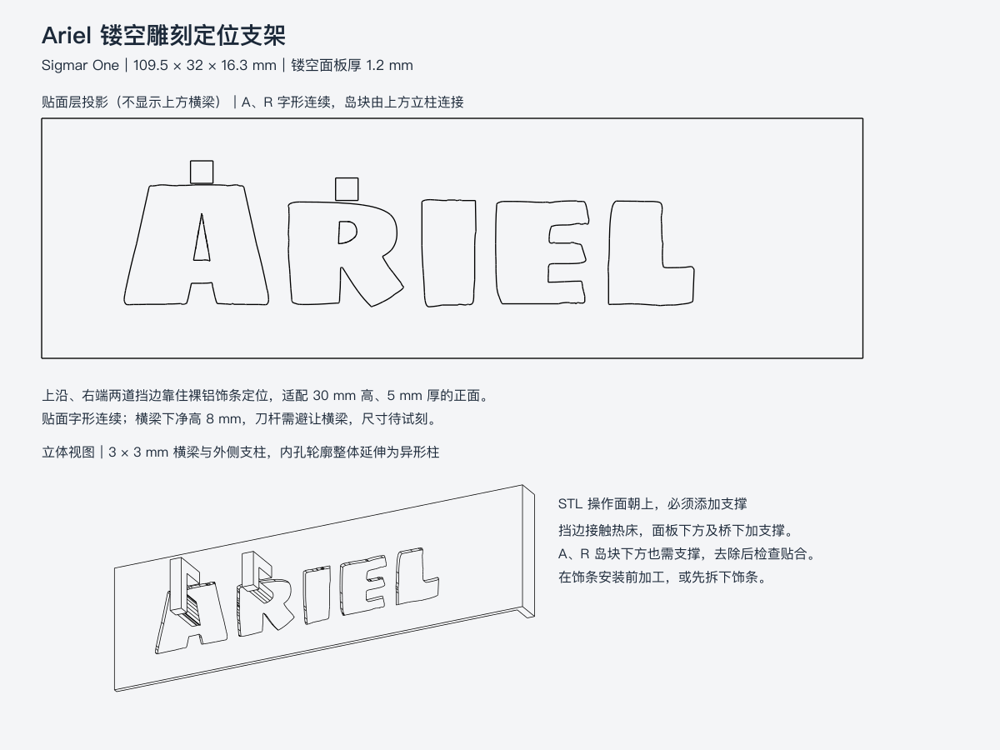

# Ariel 镂空雕刻定位支架

一件打印，无需镂空贴膜。适配本项目 **30 × 30 × 5 mm、长 425 mm** 的裸 T 型铝饰条：上挡边靠住饰条上沿，右挡边靠住切断端面；正面镂空为现有 **Ariel / Sigmar One** 字形，保持原 LOGO 的居中高度和右侧位置。



## 文件与尺寸

- [Ariel-stencil.stl](Ariel-stencil.stl)：直接导入切片软件，单位 mm；已摆好打印姿态。
- [Ariel-stencil.FCStd](Ariel-stencil.FCStd) / [STEP](Ariel-stencil.step)：同一打印姿态的独立工具模型。FCStd 保存了零件可见状态及等轴测视角，打开即可查看。
- [尺寸与几何检查](Ariel-stencil.json)：字形位置、连接桥和打印外廓。

| 项目 | 尺寸 |
|---|---|
| 打印外廓 | 109.5 × 32 × 16.3 mm |
| 接触铝面的镂空面板 | 1.2 mm 厚 |
| 上沿／右端挡边 | 2 mm 厚，向铝面背后伸出 5.3 mm |
| A、R 内孔悬吊结构 | 均向字形上方锚固；横梁宽 3 mm、厚 3 mm，外侧支柱 3 × 3 mm；下垂柱沿各自内孔轮廓整体延伸 |
| 横梁底面距铝面 | 8 mm；距面板操作侧 6.8 mm，试用净空 |
| 字形实际包络 | 约 75.992 × 16.261 mm，名义字高 16 mm |
| 字形右边缘距饰条右端 | 约 20.504 mm，沿用原 98 mm 铭牌画布内居中排字 |

A、R 内孔岛块的底面仍与铝面贴合，由上方横梁和立柱悬吊。贴面层不再有连接桥切断字形；横梁仍跨过刀具上方，不能据此认定刀杆可垂直通过。下垂柱截面积分别约为 A：6.861 mm²、R：5.802 mm²；这只是几何面积，不是抗折强度证明。横梁与外侧支柱加粗为 3 × 3 mm，桥下净高仍为 8 mm。异形柱占满原内孔投影，不侵入贴面字形，但斜向进刀余量比细圆柱方案更小；刚度和刀具可达性待试用。

这是两道定位挡边，没有弹性卡扣，也不限制刀具深度。面板厚度和 5.3 mm 挡边深度也是试用设计值；实物型材圆角、毛刺、打印收缩和刀头可达性需要试装核对。

## 打印

1. STL 按原尺寸 **100%** 导入，保持文件姿态：**操作面和悬吊横梁朝上，两道挡边接触热床，必须添加支撑**。贴铝面位于打印 Z=5.3 mm；从上方看 `Ariel` 方向正确，不要镜像模型。此版不再沿用旧版平面贴床、无需支撑的设置。
2. 首版可用 PLA，0.4 mm 喷嘴、0.2 mm 层高、3 道墙，作为试打起点。切片预览逐层核对面板、两个孤立岛块下方和两根横梁下方都有支撑；只支撑外边框不够。检查异形柱及 A 内孔尖端被完整切出，并确认桥下支撑能从侧面取出。支撑方案尚未经实际切片和打印验证。
3. 小心移除面板、岛块及横梁支撑，避免扭断异形柱或岛块尖端；清除拉丝和挡边毛刺，检查贴铝面与岛块底面平齐。先空放到裸型材核对贴合与位置。不要用刀头修整模板孔边。

## 使用

1. **安装前加工，或先拆下饰条；不要带着整机磨。** 右挡边需要包住型材端部，装机后的 0.5 mm 木侧板间隙容不下 2 mm 挡边。上挡边也需要饰条上方空出来。
2. 在同材质边角料先试刻。固定铝条，再将支架的薄面贴紧正面，上挡边和右挡边都靠实，用普通胶带压住空白边缘或用夹具固定，防止跳动；普通固定胶带不充当文字遮罩。
3. 从字形内部开始浅磨、分次接近轮廓。使用适合铝材的细刀头，先确认刀尖能伸到铝面、刀杆能避开孔壁；**切削刃不要贴塑料边高速摩擦，也不要以挡边承受侧推力**。模板辅助定位，不能保证刀头不越界或刻深一致。
4. A、R 贴面字形已经连续，不再预留旧版的两处补磨缺口。先在不开机状态检查整条轮廓：横梁下净高为 8 mm，仍可能挡住刀杆或夹头，必要时改变进刀角度；不可强行侧推异形柱。若实际刀具无法到达，应先按刀具尺寸调整横梁高度或位置。
5. 固定工件、佩戴护目镜；工件和模板发热或模板边缘受损时停机检查。银色铝面浅磨的对比度取决于原表面处理，先用试刻结果决定效果。

## 重新生成

使用 FreeCAD 1.1.1，在 **GUI 中**执行 [build-logo-stencil.FCMacro](../../tools/build-logo-stencil.FCMacro)。先关闭旧的 `Ariel-stencil.FCStd`；需要保留的手动编辑先另存副本。生成器会拒绝覆盖当前已打开的目标文件，包括指向同一文件的符号链接路径。

在 FreeCAD 的“宏 → 宏…”中，将用户宏位置设为仓库的 `tools/`，选择 `build-logo-stencil.FCMacro` 并执行。FreeCAD 尚未启动时，也可以从仓库根目录运行：

```sh
open -a FreeCAD --args "$PWD/tools/build-logo-stencil.FCMacro"
```

宏生成全部工具文件，保存零件可见性与视角，再重开导出的 FCStd 检查默认显示；它不保存其他已打开文档。直接用无界面 Python 执行生成器会被拒绝，以免再次导出缺少 GUI 显示信息的 FCStd。

宏完成后，从仓库根目录转换 PNG 并运行检查。PNG 转换另需 `rsvg-convert`；测试使用 `FREECAD_RESOURCES`，环境设置见 [整机重建的运行环境说明](../../README.md#整机重建)。

```sh
rsvg-convert previews/logo-stencil.svg -o previews/logo-stencil.png
PYTHONPATH="${FREECAD_RESOURCES:?请先设置 FreeCAD 运行环境}/lib" \
  "$FREECAD_RESOURCES/bin/python" -m unittest discover -s tests -p 'test_logo_stencil.py' -v
```

生成器读取现有 `cad/parameters.json` 的饰条与排字尺寸，复用仓库字体；面板、挡边、横梁净高／截面与立柱尺寸在 `tools/build_logo_stencil.py` 中定义。执行后覆盖本目录四种导出文件及 `previews/logo-stencil.svg`，PNG 单独转换。生成器新建并关闭独立工具文档，宏随后重开它用于查看，不打开或修改整机主 CAD。FreeCAD 自动备份沿用仓库忽略规则，不作为交付文件。

## 验证状态

2026-10-02 的加粗悬吊结构验证已完成，`test_logo_stencil.py` 的 8 项测试全部通过：

- `test_logo_stencil.py` 覆盖一体有效实体与闭合网格、裸型材定位无穿透、操作面朝上的打印变换、A／R 字形内部以 0.5 mm 网格、三个高度采样检查桥下净空、岛块全轮廓柱连续性、3 mm 梁柱实体截面、岛块底面贴合、文字边距与临时对象清理、保存导出的几何一致性、无界面导出保护及 GUI 可见性。
- FCStd／STEP 回读与当前生成几何比较；STL 检查闭合、单一连通分量和体积。
- GUI 重开确认零件显示，实际三维视口及贴面层／立体投影检查悬吊结构。贴面层预览有意隐藏上方横梁，以展示连续的加工区域。
- 几何净空检查不代表实际刀杆可达性，也不验证异形柱强度、打印支撑可拆性或雕刻效果。

工具单独交付，不加入整机装配、整机 STEP 或零件清单；现有激光铭牌模型仍保留为另一方案。以上是几何与文件验证，**尚未进行实物打印或雕刻试用**；后续待办统一记录在 [当前工作交接](../../docs/current-work-handoff.md#已知问题与待修项)。
