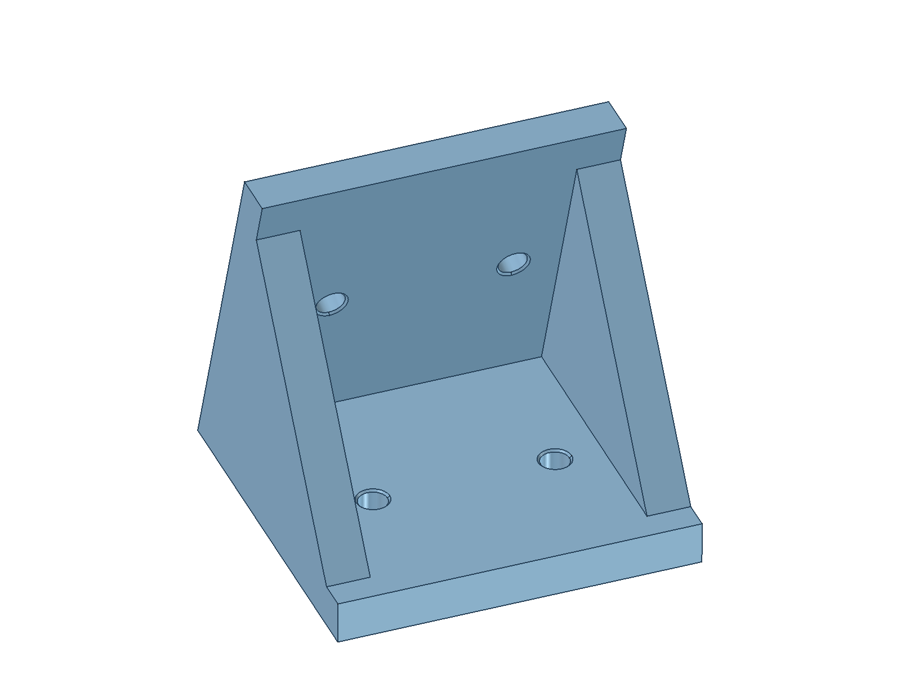

# 倾斜扬声器障板四孔加固角码

按用户修正的尺寸重做：**长 50 mm、宽 50 mm、高 50 mm，安装板和两侧三角加强筋均厚 6 mm**。两片安装板分别贴底板顶面和障板背面，内夹角为 72°；中间敞开，供旋拧螺丝。每个安装面两个 Ø4 mm 通孔，共四孔，各孔两端有 **0.3 mm × 45°** 的轻微倒角。此版替代先前的 50 × 50 × 6.5 mm 无孔实心薄片。



[尺寸与中间剖面预览](../../../previews/baffle-bracket.png)

| 项目 | 结果 |
|---|---|
| 外廓，横向 X／前后 Y／竖直 Z | 50 × 50 × 50 mm |
| 两安装板厚度 | 6 mm，障板侧按真实法向厚度计 |
| 左右三角加强筋 | 各 6 mm，中央横向开口 38 mm |
| 底板／障板贴合夹角 | 72°，读取 `cad/parameters.json` 的 `front_angle` |
| 障板侧外接触长度 | 52.573111 mm；50 mm 是竖直高度 |
| 螺丝孔 | 两个面各 2 × Ø4 mm 通孔，孔轴垂直对应安装面 |
| 横向孔位／孔距 | X=12.5／37.5 mm；孔距 25 mm |
| 从前下交线到孔中心 | 沿各安装面 30 mm；障板侧孔中心竖高 28.531695 mm |
| 孔口倒角 | 两端 C0.3 × 45°，孔口 Ø4.6 mm，直孔段长 5.4 mm |
| 底板／障板剩余接触面积 | 2466.761950／2595.417510 mm²，已扣除倒角孔口 |
| CAD 实体体积 | 36804.302051 mm³ |

## 文件和打印

- [STL](Baffle-bracket.stl)：切片输入，单位 **mm，100% 比例**；底板安装面已放在 Z=0，保持底面朝下打印。外廓应显示 50 × 50 × 50 mm。
- [FreeCAD](Baffle-bracket.FCStd)：独立零件，保存了可见状态和面向中间开口的视角。
- [STEP](Baffle-bracket.step)：与 STL 同一打印姿态的精确实体。
- [尺寸及验证报告](Baffle-bracket.json)：含四个孔的中心／轴向、装配来源 SHA-256、接触面积与导出回读结果。

底面朝下使两侧加强筋逐层向上形成，中央没有横跨开口的顶板。切片时重点检查障板侧斜向孔与孔口倒角的成形，结合打印机决定是否添加局部支撑；本次未实际切片或打印。原薄片版“三角大面平放”的打印说明已作废。

孔径按用户要求建为 Ø4 mm，没有额外增加打印补偿。材料、孔径偏差与螺丝头尺寸需实物核对；C0.3 是小孔口倒角，不是容纳沉头螺钉头部的沉孔。孔和两侧筋之间已检查名义 Ø8 × 30 mm 直线工具包络无干涉，但实际刀杆、批头、手柄和完整旋拧过程未验证。

## 装配核对

在当前主 CAD 的私有副本上核对两件角码：横向中心 **X=170／280 mm**，均位于障板后侧的中间音腔。前下接触交线为 **Y=26.514622、Z=34.5 mm**，横向范围分别为 X=145–195／255–305 mm。扣除孔口后的两个接触面与底板顶面、障板背面完整名义贴合。

每个位置检查当前 65 个物理对象，按每个 `Solid` 独立计算交叠，排除历史参考和诊断体；两处均无实体穿透。采用这对位置时，打印同一 STL 两件即可。当前交付仅包含独立角码，未加入主 CAD、整机 STEP、零件清单或图册，木板安装预孔也未新增。

螺丝型号、头型、长度、木板预孔和连接强度尚未确定。障板厚 10 mm、底板厚 12 mm，应结合实际紧固件控制进入木板的深度。名义 CAD 贴合不等于实物安装或承载验证。每件占 36.804302 cm³，尚未从主音腔容积报告中扣除。

## 重新生成与验证

使用 FreeCAD 1.1.1 的 GUI 执行 [build-baffle-bracket.FCMacro](../../../tools/build-baffle-bracket.FCMacro)。先关闭已打开的目标角码文件，需要保留的手工编辑先另存。该宏只生成此独立打印件，回读目标确认默认可见；不会保存其他打开的文档。

FreeCAD 关闭时可从仓库根目录启动：

```sh
open -a FreeCAD --args "$PWD/tools/build-baffle-bracket.FCMacro"
```

FreeCAD 已运行时，从宏对话框执行。若障板角度或主装配参数改变，先按项目流程重建主装配，再生成角码；生成器拒绝与当前参数不一致的保存 CAD。外廓、板厚、孔位、倒角和横向安装位置在 [生成器](../../../tools/build_baffle_bracket.py) 中定义。

运行环境设置见 [主 README](../../../README.md#整机重建)。在仓库根目录执行：

```sh
rsvg-convert previews/baffle-bracket.svg -o previews/baffle-bracket.png
PYTHONPATH="${FREECAD_RESOURCES:?请先设置 FreeCAD 运行环境}/lib" \
  "$FREECAD_RESOURCES/bin/python" -m unittest discover -s tests -p 'test_baffle_bracket.py' -v
git diff --check
```

2026-10-04：7 项专项测试通过，覆盖 50 × 50 × 50 mm 外廓、6 mm 板／筋与开放中央、非默认角度、四个 Ø4 mm 法向通孔、八处 C0.3 孔口倒角、名义直线工具净空、两处完整接触及全装配无干涉、移位失去贴合、Compound 全包含碰撞拒绝、过期参数拒绝、FCStd／STEP 双向布尔差、闭合单分量正体积 STL、GUI 可见性／相机及无界面导出保护。保存文件已实际回读，模型视口和尺寸预览已检查；STL 为 7636 个三角面，体积与 CAD 差约 0.163 mm³。
