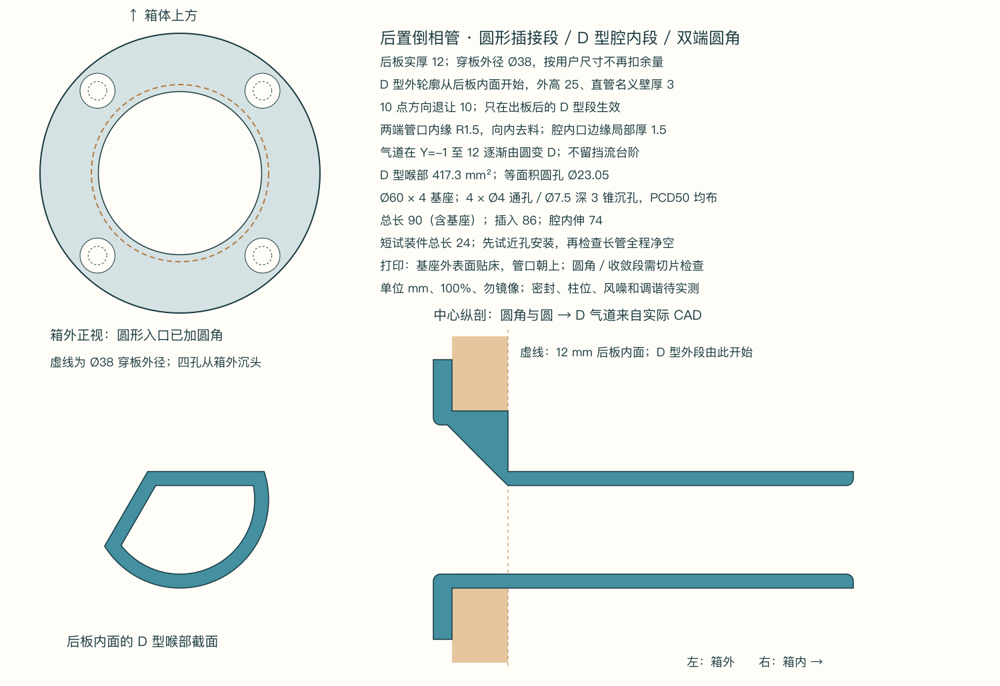

# 后置 D 型倒相管 · 试装版

按用户修正采用 **Ø38 mm 管外径、12 mm 厚后板和正圆开孔**，由箱外沿轴线插入。穿过后板的 **0–12 mm 外轮廓是完整 Ø38 mm 正圆**；从后板内面开始改为 **25 mm 外高的 D 型**，让开上方盖板，并以左上斜面让开从箱外看 **10 点钟**方向的螺丝柱。直管名义壁厚 **3 mm**；柱体尺寸尚未测量，已授权先按暂定避让尺寸试装。

本版两端管口内缘加入 **R1.5 mm 圆角**，在原材料内去料，不扩大外部安装轮廓。外基座 Ø60 × 4 和 PCD50 四孔位置保留，总长按用户认可的新试验建议由 80 增至 **90 mm**。四个通孔按用户最新要求改为 **Ø4 mm**，从箱外增加入口 **Ø7.5 mm、深 3 mm** 的锥形沉孔。圆到 D 的内气道在基座／圆形插接段内逐渐收敛，避免在出板位置形成突然挡流的台阶。端口圆角有助于减轻气流分离引起的噪声，但不保证消除风噪；参见 [AES 论文摘要](https://aes2.org/publications/elibrary-page/?id=11094)。



## 文件

- `Bass-port-D25.stl`：完整倒相管，打印外廓 **60 × 60 × 90 mm**。
- `Bass-port-D25.FCStd` / `.step`：同一打印姿态的独立实体，FCStd 已保存可见性与视角。
- `Bass-port-fit-coupon.stl` / `.FCStd` / `.step`：同基座、12 mm 圆形插接段、内气道渐变和双端圆角的短试装件，外廓 **60 × 60 × 24 mm**。先打印它检查圆孔、四个沉头螺孔、上方盖板和近孔螺丝柱；短件插入只有 20 mm，其中腔内 D 型段长 8 mm，不能代替全长检查。它是试装件，不与长管叠加安装。
- `Bass-port-report.json`：尺寸、通气面积、名义安装路径和文件回读检查。
- [源参数](../../../cad/bass-port-print.json)：修改入口；本次参数快照保存在 `Bass-port-report.json` 中。
- `SHA256SUMS`：独立文件校验值。按需调用 `package()` 可生成上一级 ZIP，仓库只保存独立文件。

## 尺寸与方向

| 项目 | 本版尺寸／含义 |
|---|---|
| 开孔基准 | 后板为正圆孔；用户说明原 Ø38 尺寸已经包含所需余量，直接采用管外径 Ø38，不再额外减径；实际木孔间隙未重新测量 |
| 后板厚度 | 用户确认 12 mm；后板外面为安装 Y=0，内面为 Y=12 |
| 圆形插接段 | 外径 Ø38、长 12 mm；按用户给定尺寸，不再扣减额外打印间隙 |
| D 型外高 | 出板后为 25 mm；不是内孔高度，也不是穿板圆段高度 |
| 管壁 | 直 D 段圆弧、平顶、斜面按法向 3 mm，喉部内高 19 mm；圆→D 过渡局部加厚，腔内口圆角边缘局部减薄至 1.5 mm |
| D 型实际最大宽度 | 约 35.161 mm；圆形插接段为 Ø38 |
| 10 点避让 | D 型段沿该径向从母圆内退 **10 mm（用户指定）**；只从后板内面开始，不削掉穿板圆段 |
| 内气道渐变 | 从基座内 Y=-1 到后板内面 Y=12，由 Ø32 圆孔逐渐收敛为 D 型喉部；外圆轮廓不变 |
| 两端圆角 | 外部圆形入口与腔内 D 型出口内缘均 R1.5，原轮廓内去料；入口开口 Ø35，内部口面积约 542.58 mm² |
| 外基座 | Ø60 × 4 mm；基座在箱外，覆盖名义 Ø38 开孔外的密封区域 |
| 固定孔 | 4 × Ø4 通孔，Ø50 分布圆、间隔 90° 均布；按用户最新要求给 Ø3.8 螺杆留通孔间隙 |
| 斜面沉孔 | 箱外入口 Ø7.5、轴向深 3、底部接 Ø4；将用户本次“3 mm”理解为沉孔深度，构成完整锥面，夹角约 60.513°；沉孔底下仍有 1 mm 基座，最外缘保留 1.25 mm 材料。真实螺帽轮廓与打印贴合待试装 |
| 螺孔位置 | 从木孔圆心量，箱外看 X 向右、Z 向上，四组 (±17.678, ±17.678) mm；约为 1:30、4:30、7:30、10:30 方向 |
| 总物理长度 | 90 mm，含箱外 4 mm 基座；从后板外面向内插入 86 mm |
| 腔内伸长 | 按用户确认的 12 mm 后板厚度为 74 mm；垫片厚度会改变插入量 |
| D 型喉部截面 | 约 417.29 mm²；等面积圆孔约 Ø23.05 mm，是旧 Ø32 内孔面积的 51.89%；圆角仅扩开端口，不缩小此喉部 |

钟点方向始终以**站在箱外正对后板**为准；平顶向上、斜面在左上。STL 的打印姿态与安装姿态相差刚体旋转，没有镜像；切片文件中的平顶方向是打印坐标 -Y。安装时按尺寸图识别方向，不能依照切片软件默认相机猜钟点方向。

## 打印和试装

1. 按 **毫米、100%** 导入，保持导出姿态：**基座外表面贴热床，管子竖直向上**。本版内气道含圆角与收敛段，不能沿用旧版“全长恒截面”的切片判断；检查首层入口圆角和圆→D 收敛段的悬垂，支撑方案需按实际切片确认，任何支撑均不得永久封堵气道。实际切片、打印气密性与收缩尚未验证，不能为了压入而整体缩放模型。
2. 先打印短试装件，清掉首层外扩和毛刺；平顶朝上、斜面朝左上，徒手从箱外插入。不要通过拧紧螺钉强行拉入干涉的管子。短件不能确认更深处的螺丝柱和其他部件，完整长管仍需全程干装。
3. 若 10 点方向仍碰柱，测量柱子相对孔圆心的位置、大小和沿插入方向的范围，再调整 `clock10_radial_relief`。本版按用户要求退让 10 mm，实际柱体净空仍需试装。上盖板位置、基座外部空间、木孔粗糙度和实际打印间隙也需要核对。
4. 基座四个孔均在木孔外，但后板可用木料、已有孔位和背后障碍尚未核实。先定位再钻导孔，按实际后板和螺钉选导孔与长度，避免钻穿或碰到内部件。当前定义 Ø4 塑料通孔及 Ø7.5 × 3 锥形沉孔，不指定未经确认的木螺钉长度。先用短试装件检查螺杆能否通过、螺帽是否贴合沉孔及齐平；本版沉孔角度随深度变为约 60.5°；此前螺帽实测高度仍为 2.5 mm，真实螺帽锥面并未独立测量，避免过紧挤裂塑料。
5. 基座与后板之间做**连续、可拆的气密密封**，四个螺钉孔也要密封。管外径为用户已含余量的 Ø38，本版不再额外减径；实际孔与打印件之间如有余隙，由基座和密封层封住。名义几何覆盖不代表实物打印层纹、接触面或螺钉已经气密。密封垫厚度未计入长度。

## 调谐边界

本版按用户认可的建议将总长由 80 增至 **90 mm（含外基座）**，作为试验起点。用户估计低音腔为 300 × 180 × 75 mm，并说明只有 300 mm 包含 12 mm 板厚。暂按长度两端各有 12 mm 板计算，内部为 276 × 180 × 75 mm，毛容积 **3.726 L**；若仅含一块板，则毛容积为 3.888 L。两端板的解释尚未独立确认，以上均未扣喇叭、倒相管等占用，不能当作实测净容积。较此前估算更小的容积促使本轮略加长管子，但 90 mm 仍是试验选择，未确定目标调谐频率。

10 点方向退让从 5 增加到 10 mm 后，3 mm 壁厚的 D 型喉部面积由约 477.31 减至 **417.29 mm²**（减少约 12.57%），等面积圆孔约 Ø23.050 mm。

根据 [Helmholtz 共振关系](https://phys.unsw.edu.au/jw/Helmholtz.html)，同净容积、同目标调谐、恒定截面时，有效管长按通气面积比例缩放。仅把当前喉部假定为全长恒定截面，并借用圆管端部修正 `0.732 × 等面积内径`，与原 Ø32 × 160 圆管比较可得：

```text
原有效长 ≈ 160 + 0.732 × 32 = 183.424 mm
面积比 ≈ 417.294 / 804.248 = 0.518863
恒截面比较有效长 ≈ 183.424 × 0.518863 = 95.172 mm
恒截面比较物理长 ≈ 95.172 - 0.732 × 23.050 = 78.299 mm
上述为历史同净容积比较；本版选用试验总长 90 mm（含外基座，不另加板厚）
```

上述比较**不能作为本版变截面和圆角管的调谐预测**。圆形入口和渐变段具有不同截面积，气柱惯性与沿长度的 `∫dy/A(y)` 有关，不能将整个 90 mm 都当作 417 mm² 恒截面。两端圆角也改变端部修正，实际邻近板件与实物净容积尚未确认。历史 78.3 mm 比较没有计入本轮箱体容积变化；90 mm 是在更新尺寸后选用的样机起点，后续长度按测量调整；原圆管和本版均没有实测调谐。圆角不会补回 D 型喉部的通气面积，风噪、声压与单元振幅均未实测。

这是独立打印件。主装配仍保留原圆管，未改写主 CAD、STEP、参数、盖板文件、图册或整机声学验证报告。

## 验证和重建

FreeCAD 1.1.1 专项检查覆盖完整 Ø38 × 12 mm 圆形穿板外轮廓、出板后 D 型／10 点避让、喉部 3 mm 法向壁厚、双端 R1.5 几何和口部扩展、圆→D 收敛及连续气路、四个 Ø4 通孔、分布圆／90° 间距及箱外 Ø7.5 × 3 锥形沉孔和剩余壁厚、历史长度换算的适用边界、名义 Ø38 开孔参考与盖板／10 点斜面假设障碍、从箱外的抽插路径，以及基座对圆孔余隙的完整覆盖。FCStd／STEP 回读与生成实体做双向布尔差；STL 使用 Netgen 网格，检查单一闭合连通分量、非流形、自交、尺寸及体积。网格外廓误差限 0.01 mm，体积相对误差限 0.02%，实际读数保存在报告中。实际柱体和整机安装没有实测验收。

修改 `cad/bass-port-print.json`，关闭旧的两个输出 FCStd，手工修改需要保留时先另存。在 FreeCAD GUI 执行 `tools/build-bass-port-print.FCMacro`；宏只生成独立文件，并重开长管检查显示，不保存其他文档。主程序拒绝无界面导出。PNG 转换及打包刷新从仓库根目录运行：

```sh
rsvg-convert output/3d-print/bass-port/dimensions.svg -o output/3d-print/bass-port/dimensions.png
PYTHONPATH="${FREECAD_RESOURCES:?请先设置 FreeCAD 运行环境}/lib" \
  "$FREECAD_RESOURCES/bin/python" -c 'import sys; sys.path.insert(0, "tools"); import build_bass_port_print as p; p.package()'
PYTHONPATH="${FREECAD_RESOURCES:?请先设置 FreeCAD 运行环境}/lib" \
  "$FREECAD_RESOURCES/bin/python" -m unittest discover -s tests -p 'test_bass_port_print.py' -v
```
