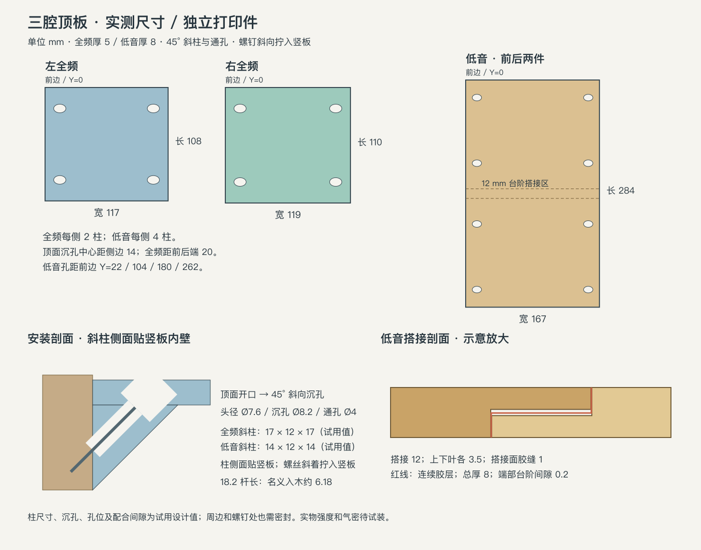
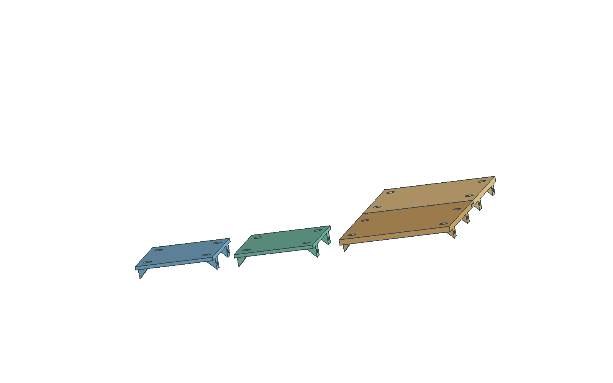
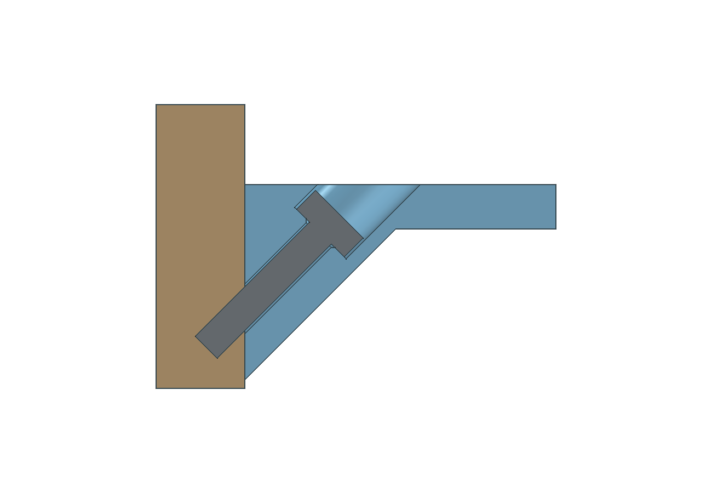

# 三腔顶板：嵌入式独立打印件

按实测开口制作左、右全频顶板各一件，低音顶板分成前、后两件。按用户最新要求，左、右全频主体厚度为 **5 mm**，低音主体厚度为 **8 mm**；全频板保留左右尺寸差异，低音板按用户后续修正采用 **167 × 284 mm 矩形**。

板嵌在声腔内，长方向的两侧下方有 **45° 三角固定柱**。固定柱的竖直外侧面贴木竖板内壁；螺丝从顶面斜向沉孔穿过板和固定柱，以 45° 向外、向下拧入木竖板。不是向下拧入柱底部的横木板。



## 下载与尺寸

| 打印件 | STL | STEP / FreeCAD | 打印外廓（宽 × 长 × 高，mm） | 柱数 |
|---|---|---|---|---:|
| 左全频 | [FullrangeLeft.stl](FullrangeLeft.stl) | [STEP](FullrangeLeft.step) / [FCStd](FullrangeLeft.FCStd) | 117 × 108 × 22 | 4 |
| 右全频 | [FullrangeRight.stl](FullrangeRight.stl) | [STEP](FullrangeRight.step) / [FCStd](FullrangeRight.FCStd) | 119 × 110 × 22 | 4 |
| 低音前半 | [WooferFront.stl](WooferFront.stl) | [STEP](WooferFront.step) / [FCStd](WooferFront.FCStd) | 167 × 148 × 22 | 4 |
| 低音后半 | [WooferRear.stl](WooferRear.stl) | [STEP](WooferRear.step) / [FCStd](WooferRear.FCStd) | 167 × 147.8 × 22 | 4 |

四件均在 **256 × 256 × 256 mm** 打印范围内；外廓尚未计入切片裙边和底座。全频为 5 mm 主体加下方 17 mm 斜柱，低音为 8 mm 主体加下方 14 mm 斜柱，总高均为 22 mm。减薄后柱子向腔内和板下的伸出增加，须实物核对与喇叭的避让。

[Chamber-roofs.FCStd](Chamber-roofs.FCStd) 用安装方向展示三个板区，其中低音前后两半处于实际拼合位置。左右全频板仅为分组展示，不代表三块在箱体中的全局位置。这个文件有四个根层实体，不含木板、螺丝或整机。

单件 STL、STEP、FCStd 均为相同的打印姿态；切片时只导入对应单件 STL。[参数与验证报告](chamber-roofs.json) 和 [SHA-256 清单](SHA256SUMS) 可用于核对文件。



## 斜柱与螺丝

用户提供：自攻螺丝杆径 **3.5 mm**、长度 **18.2 mm**、头径 **7.6 mm**，固定方向 **45°**。全频每条 108／110 mm 边各两柱；低音每条 284 mm 边各四柱。

以下为本版试用设计值，尚未实物验证：

- 每柱沿边宽 12 mm；全频向腔内／板下各伸出 17 mm，低音各伸出 14 mm；斜面与孔轴为 45°，竖直柱面贴木竖板。
- Ø4 mm 斜向通孔让 Ø3.5 mm 螺杆穿过塑料，螺纹应咬入木板。沉孔 Ø8.2 mm，相对头径留 0.6 mm 直径余量；沉孔底为垂直于螺丝轴的平环形座，通孔入口 C0.3。没有按未提供的沉头角度制作锥形头座。
- 头座中心距侧边 8.5 mm，距顶面向下 5.5 mm。以各板底为 Z=0，全频头座位于 Z=-0.5 mm 的斜柱内，低音头座位于 Z=2.5 mm；通孔轴分别在板底以下 9／6 mm 处穿出柱侧面。顶面椭圆开口的中心距侧边 14 mm。
- 全频孔位距前后端各 20 mm；低音从前边量 Y=22、104、180、262 mm。所有位置以安装方向为准，打印翻转后的坐标不同。
- 暂按 **18.2 mm 为头下杆长**计算，塑料内轴向路径为约 12.021 mm，名义入木长度约 **6.179 mm**；不能据此认定自攻螺钉抗拔足够。若 18.2 mm 含螺钉头，或加垫片，入木长度会减少。

螺钉头高度和底面形状尚未提供。Ø7.6 × 高 3 mm 的平底圆柱头仅用于临时剖面和通路检查，**不保存在交付 CAD 中，也不代表实际螺钉模型**。按这一圆柱包络，头高不超过约 3.98 mm 时可完全低于顶面；真实头型与打印孔径仍需试装。若实际为沉头螺丝，应按头部角度重做座面。



剖面中的木板厚 10 mm、螺钉头高 3 mm 是显示假设。检查使用临时竖板验证理想接触与通路，未证明实际木板厚度、木纹方向、预钻孔或安装强度。外围保持用户给定尺寸，未自动扣除打印收缩或装配间隙。

## 低音分块和密封

名义分界位于前边后 142 mm。搭接区 Y=136–148 mm，前半保留上叶，后半保留下叶；上下叶各厚 **3.5 mm**，水平搭接面之间按用户要求预留 **1 mm** 胶层间隙（下叶顶 Z=3.5，上叶底 Z=4.5）。后半沿长度方向退让 0.2 mm，两处竖向台阶也有 0.2 mm 配合间隙。拼合后完整外廓仍为 **167 × 284 × 8 mm**，不含斜柱。

台阶增加密封路径，不能保证干拼气密。搭接面及两道台阶必须形成连续密封胶层；板周边与木板之间、螺钉穿出竖板处同样需要密封。密封材料需与所用打印材料和木材相容，使用和固化条件按其厂家说明执行。

安装顺序：先放后半，再把前半从上方落到后半的下叶上。完成试装后处理搭接及周边密封，用 1 mm 厚量规检查搭接面胶缝、确认两半顶面齐平，再交替轻拧螺丝；紧固时保持胶缝，勿把上下叶拉成直接接触；勿靠拧紧螺丝强行拉平翘曲。前半在后半上方 0–22 mm 的逐毫米落入检查无两件间穿透；检查不含实物竖板误差、工具及浮动台面。

## 打印

1. 单件 STL 按 **mm、100%** 导入。文件已经把安装时的平整顶面翻到热床，斜柱朝上；是刚性旋转，不要再镜像或翻面。
2. **低音后半需要在搭接下叶下添加局部支撑**：此打印姿态下，搭接悬伸区位于床面上方 4.5 mm。先检查支撑能完整覆盖并可从搭接端拆出。其余部位及 45° 斜孔也需逐层检查切片结果，未进行实际切片验收。
3. 切片参数、材料和填充由实际设备确认。CAD 中的实心体不等于切片采用 100% 填充；封闭外皮、孔壁和搭接面必须完整，不能把填充率当作气密保证。
4. 打印前先核对 7.6 mm 螺钉头、螺杆长度及木板支承位置。打印后清理支撑与孔内拉丝，确认四面平直、柱面贴壁和接缝余量，再试装与密封。真实气密、强度、翘曲和扬声器振动影响未验证。

## 本版厚度与局部头座

本版已采用全频 **5 mm**、低音 **8 mm**，低音搭接面胶缝 **1 mm**。为容纳 Ø7.6 螺钉头，保留 Ø8.2 头孔，头座相对顶面仍下沉 5.5 mm；全频头座因此落入局部斜柱，而非要求整块薄板容纳完整斜向头座。

斜柱的板下深度由 22 mm 总高减去各板厚得到，分别为 17／14 mm。检查覆盖完整环形头座后方的材料、45° 螺杆和工具通路；这种局部支承不能证明 5 mm 平板的实物刚度。搭接叶各为 3.5 mm，1 mm 为两叶间的法向胶层间隙，两端竖向台阶仍保留 0.2 mm 装配间隙。

本版属于可打印的试装几何；实际材料、层向、填充、翘曲、紧固抗拔及声腔气密仍需试装核对。安装时不要以密封胶代替固定柱，也不要把未固化胶层拧到零间隙。

## 重新生成与验证

源尺寸在 [cad/chamber-roofs.json](../../../cad/chamber-roofs.json)，与整机 `parameters.json` 分开；生成器为 [build_chamber_roofs.py](../../../tools/build_chamber_roofs.py)。使用 FreeCAD 1.1.1 GUI，关闭旧的五个输出文档并另存需要保留的手动编辑，再执行 [build-chamber-roofs.FCMacro](../../../tools/build-chamber-roofs.FCMacro)。目标路径含符号链接的打开文件也会阻止覆盖。

FreeCAD 未启动时，可从仓库根目录运行：

```sh
open -a FreeCAD --args "$PWD/tools/build-chamber-roofs.FCMacro"
```

宏只保存独立打印件及其预览，不打开或保存整机。无界面调用 `export()` 会被拒绝，避免输出缺失可见状态的 FCStd。生成文件通过回读检查后才从临时目录移入交付目录。

尺寸 PNG 另用 `rsvg-convert` 生成；FreeCAD 运行环境沿用主 README：

```sh
rsvg-convert output/3d-print/chamber-roofs/dimensions.svg -o output/3d-print/chamber-roofs/dimensions.png
PYTHONPATH="${FREECAD_RESOURCES:?请先设置 FreeCAD 运行环境}/lib" \
  "$FREECAD_RESOURCES/bin/python" -m unittest discover -s tests -p 'test_chamber_roofs.py' -v
git diff --check
```

2026-10-05：10 项专项测试通过，四个 FCStd／STEP 回读几何一致；四个 STL 均为闭合单一连通分量，没有非流形边或自相交。测试覆盖 5／8 mm 实测板厚、完整环形头座支承、1 mm 搭接胶缝、外廓、柱数、45° 自由通孔、螺钉头试用包络与工具通路、竖板理想接触、接缝间隙与落入路径、打印变换、设备外廓、错误参数拒绝、GUI 可见状态／相机以及导出与报告一致性。

三腔顶板是独立实测打印方案，未替换整机 `AcousticRoof`，也未加入整机 STEP、零件清单、图册或导览。主 CAD 的机芯孔与弹性支承凹槽不自动复制到这些实测板上；安装与浮动台面相邻时，需要另核对实际孔位和净空。
