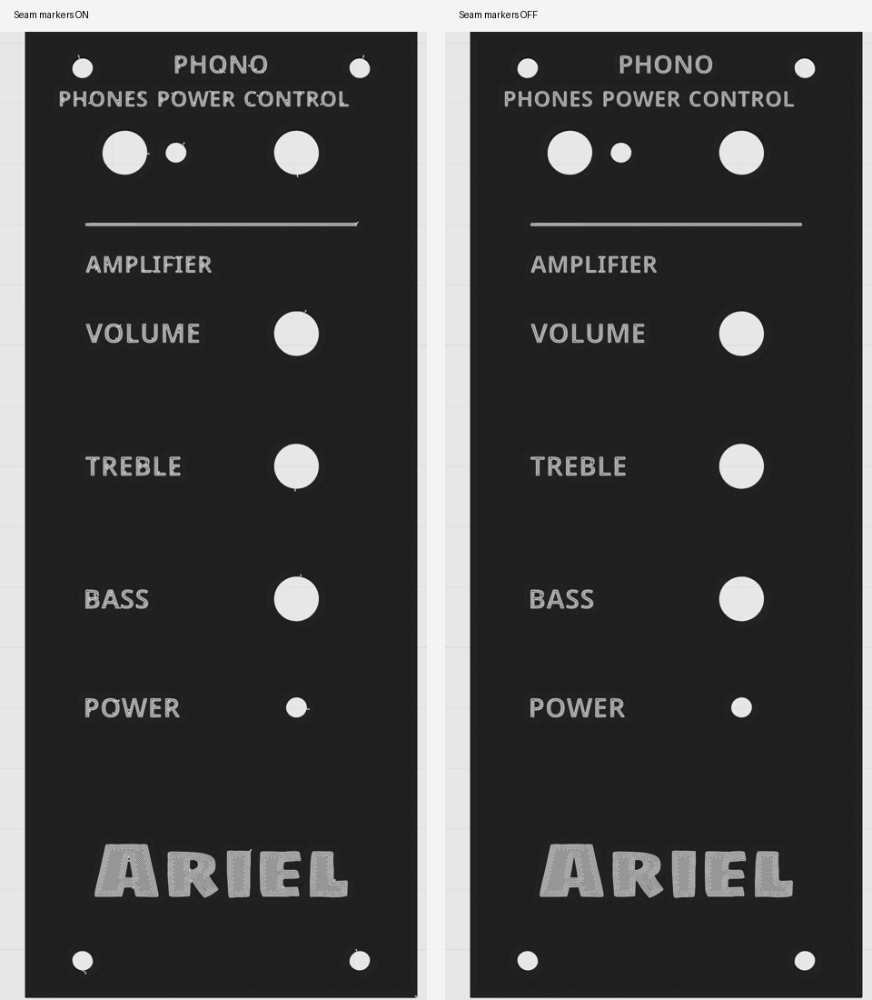
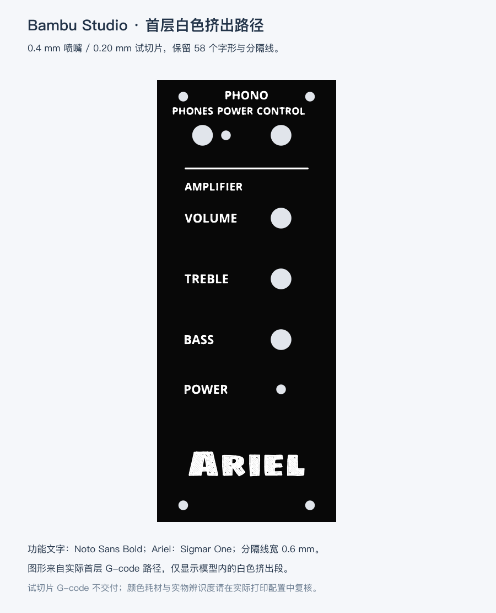

# 唱机 + 音响旋钮面板

本版按打印安装反馈调整为 **65 × 160 × 3.5 mm**，总厚 **13.5 mm**；替代此前 60 × 160 mm 文件。宽度从原面板左右各增加 2.5 mm，原有孔位与文字相对新左边缘整体加 2.5 mm。耳机孔单独按旧基准 X=14 换算为新 **X=16.5 mm、Ø7.5 mm**。左右背面定位条分别相对原安装基准向外移动 2.5 mm；上下开放，两条各 **1.5 × 135.4 × 10 mm**。此调整版尚未再次打印试装。

黑色底件与白色文字、分隔线、Ariel LOGO 是两组独立几何。白色标识为 **0.5 mm 齐平嵌字**，黑色底件有对应凹槽，字底保留 3 mm 板厚。功能字使用 Noto Sans Bold，Ariel 使用 Sigmar One；A/R 内部区域通过底板连接，黑色底件为一个连续实体。


## 孔位与标识

正面左上角为原点，X 向右、Y 向下，单位 mm。所有孔为直孔，无沉头或孔径补偿。

| 功能 | X | Y | 孔径 |
|---|---:|---:|---:|
| 唱机耳机输出 | 16.5 | 20 | 7.5 |
| 唱机电源 LED | 25 | 20 | 3.5 |
| 唱机旋钮 | 45 | 20 | 7.5 |
| VOLUME | 45 | 50 | 7.5 |
| TREBLE | 45 | 72 | 7.5 |
| BASS | 45 | 94 | 7.5 |
| 音响电源 LED | 45 | 112 | 3.5 |
| 左上固定 | 9.5 | 6 | 3.5 |
| 右上固定 | 55.5 | 6 | 3.5 |
| 左下固定 | 9.5 | 154 | 3.5 |
| 右下固定 | 55.5 | 154 | 3.5 |

全部功能字、LOGO 与分隔线可以分色打印。顶排 PHONES 中心 X=13，POWER 中心 X=28.5，CONTROL 中心 X=45，基线 Y=12.5，字高 2.6 mm；保留原有文字间距。PHONO 中心 X=32.5、字高 3 mm，AMPLIFIER 字高 2.8 mm。音响标识字高 3.2 mm，基线 Y=51.6、73.6、95.6、113.6；分隔线 X=10、Y=32、长 45、宽 0.6 mm。Ariel 宽 42 mm，中心 **(32.5,139)**，范围约 **X=11.5–53.5、Y=134.51–143.49 mm**。参数与字体源见 [几何参数](../../../cad/control-panel.json)。

Ø14 旋钮帽与 Ø7 螺丝头仅为预览投影，不包含在打印件中。

## 文件与打印

- **[0.2 mm 喷嘴 Bambu Studio 项目](Control-panel-bambu-0.2mm.3mf)**：P2S 0.2 mm、0.10 mm Standard、Arachne；面板耗材 1（黑）、文字与 LOGO 耗材 2（白）。已在 GUI 完成切片，并读取保存文件验证分色与网格；模型几何未改变。预估 135 层、4 小时 22 分钟、29.72 g、5 次换料。本项目不含 G-code，重新打开后需切片。

2026-10-07 GUI 核对发现字母拐角及孔边的白点属于“缝”显示标记；关闭后消失，关闭此显示不改变打印接缝本身。保留标准线宽 0.22 mm、首层线宽 0.25 mm，不因这些显示标记调整流量、温度或接缝间隙。当前设备端登记仍为 0.4 mm，需要在打印机屏幕将喷嘴直径改为实际已装的 0.2 mm；BambuStudio 的“打印机零件”页面为只读。详见 [0.2 mm 检查记录](Control-panel-bambu-0.2mm-check.json)。实际 0.2 mm 打印效果尚未验证；[设备喷嘴登记截图](../../../previews/control-panel-bambu-device-nozzle.png)记录本次核对状态。



- **[Bambu Studio 原生项目](Control-panel-bambu.3mf)**：优先以“文件 → 打开项目”载入。一个父对象 `Control panel` 下有 `Panel`、`Letters and Ariel` 两个零件；分别指定耗材 1（黑）、2（白）。带 P2S 0.4 mm、0.20 mm、Arachne 起始配置，不含 G-code。调整版已用 Bambu Studio 命令行导入、导出和试切片验证；本轮 GUI 自动化两次读取超时，未完成更新版 GUI 核对。上一版已实际验证文字独立改色，本版保留相同零件分配结构。
- [通用分色 3MF](Control-panel-color.3mf)：两组网格与共同坐标。Bambu GUI 会将其视为第三方几何，可能沿用当前项目耗材；优先使用原生项目。
- [黑色底件 STL](Control-panel.stl)：一个闭合连通网格，含全部凹字，外廓 **65 × 160 × 13.5 mm**。
- [白色文字／LOGO STL](Control-panel-markings.stl)：59 个闭合字形／线条分量，与底件保持共同坐标，位于打印 Z=0–0.5 mm。
- [FCStd](Control-panel.FCStd)、[STEP](Control-panel.step)：黑色底件与白色标识两组几何，共 60 个实体；FCStd 保存颜色与可见性。
- [1:1 面板孔轮廓](Control-panel-outline.svg)：外边界与 11 个面板孔，不是木板窗口模板。
- **[A4 木板开孔纸样](../../pdf/control-panel-cutting-template-A4.pdf)**、[纸样检查记录](../../pdf/control-panel-cutting-template-A4.json)：打印“实际大小 / 100%”，关闭“适合页面”，先核对 100 mm 标尺和 50 × 50 mm 方框。实线为木板窗口，虚线为面板定位外廓，十字为木板导孔中心；导孔直径按螺丝牙型和木材另定。
- [参数与哈希报告](Control-panel.json)、[Bambu 检查记录](Control-panel-bambu-check.json)。
- [固定示意图](../../../previews/control-panel-mounting-concept.html)与[旋钮帽净空预览](../../../previews/control-panel-knob-clearance.png)。

**正面朝下，背面定位条朝上；单位 mm，100% 比例。** CAD 底板 Z=0–3.5、定位条 Z=−10–0、嵌字 Z=3–3.5。打印坐标由绕 X 轴旋转 180° 并平移得到：X=x、Y=y、正面 Z=0、嵌字 Z=0–0.5、定位条 Z=3.5–13.5，没有镜像。两色在前 0.5 mm 的相同层内出现，需要支持同层换色的设备。

从 STL 导入时，同时选择两份 STL，并使用“作为一个包含多个零件的对象”；不要单独重新居中。只导入底件 STL 没有独立白色文字。打开原生项目后，在“准备 → 对象”展开父对象，在两个零件的“耗材丝”编号格分别选色。不要在父对象上统一换色。切片建议使用 Arachne，实际打印前核对细字路径。

## 木板窗口与定位条

10 mm 木板窗口当前试排为 **59.4 × 136 mm**，从 **(2.8,12)** 到 **(62.2,148)**；左右搭边各 2.8 mm，上下固定木条各 12 mm。两条定位条占用外廓 **58.8 × 135.4 mm**，从 **(3.1,12.3)** 到 **(61.9,147.7)**。左条 X=3.1–4.6，右条 X=60.4–61.9，Y 均为 12.3–147.7，插入深度 10 mm；与窗口每边留 0.3 mm 试装间隙，无弹性倒钩。

PCB 与面板成 90°、向箱体内部延伸。唱机耳机中心到 PCB 左缘 10 mm 已记录。音响 LED 中心 Y=112，其 PCB 底部在其下方 45 mm，故下缘参考 Y=157，距面板底边 3 mm。窗口下边仍为 Y=148，与 PCB 下缘有 **9 mm 投影重叠**；这次宽度调整不改变该纵向关系，实际深度和元件空间仍需试装核对。

螺杆 Ø3.2、头径 Ø7；面板固定孔 Ø3.5，单边间隙 0.15 mm。固定孔 X=9.5/55.5、Y=6/154。木板导孔、螺丝长度与握钉强度另定，Ø3.5 不是木板导孔规格。

## 重新生成与验证

在 FreeCAD 1.1.1 GUI 执行 [build-control-panel.FCMacro](../../../tools/build-control-panel.FCMacro)，先关闭目标，手工修改需另存。只更新独立面板，不修改主装配。

```sh
open -a FreeCAD --args "$PWD/tools/build-control-panel.FCMacro"
```

在含 ReportLab 的 Python 中执行 `tools/control_panel_template.py --font "$PDF_FONT"` 重建纸样，`PDF_FONT` 指向可嵌入的中文 TrueType 字体。字体路径为本机运行参数。

```sh
rsvg-convert previews/control-panel.svg -o previews/control-panel.png
PYTHONPATH="${FREECAD_RESOURCES:?请先设置 FreeCAD 运行环境}/lib" \
  "$FREECAD_RESOURCES/bin/python" -m unittest discover -s tests -p 'test_control_panel.py' -v
git diff --check
```

生成器输出 CAD、STEP、STL、通用 3MF、报告与主预览。原生 Bambu 项目应重新导入最新几何、指定两个耗材并另存；随后更新固定示意图、试切片预览与纸样检查记录。外观参数在 [颜色参数](../../../cad/control-panel-appearance.json)，STL 不保存颜色。

调整版 9 项专项检查全部通过，覆盖保存的尺寸、孔位、贯穿深度、定位条、嵌字、STL 拓扑和分色结构。试切片 59 个字形／线条区域均有白色路径；这只证明区域内存在路径，不保证完整细字笔画或实物可读性。试切片仍有 `Invalid T command (T65535)` 结束代码诊断，试用 G-code 未交付。Bambu 起始配置需要按实际设备核对。


