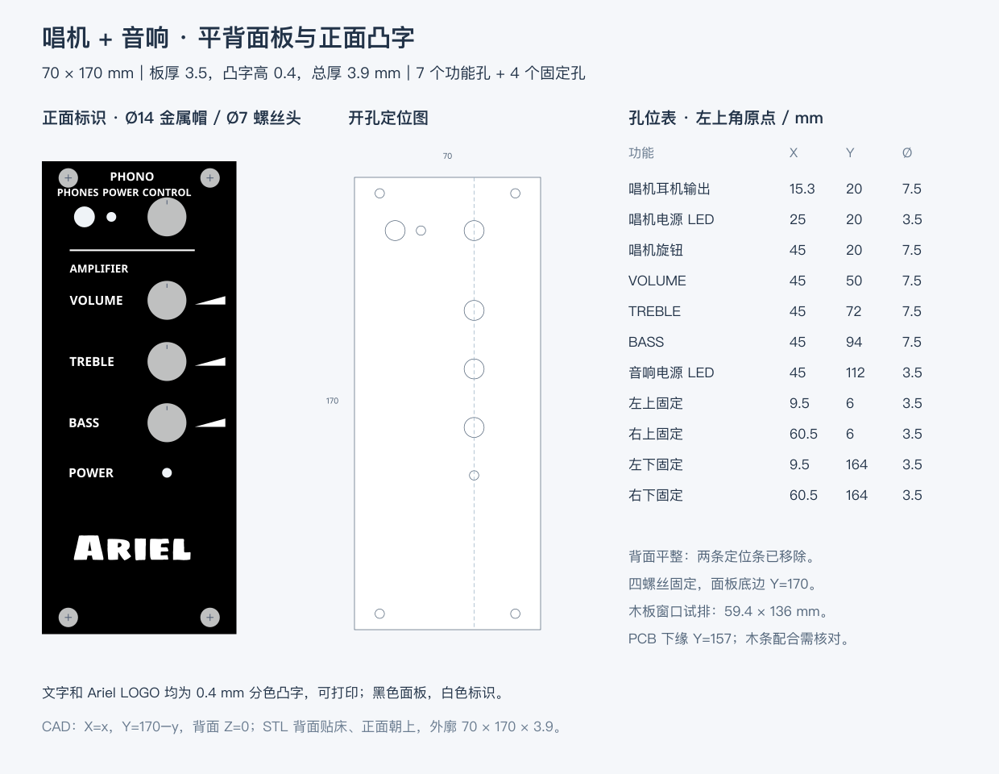
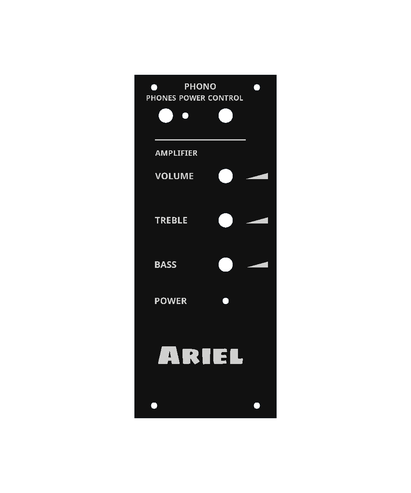
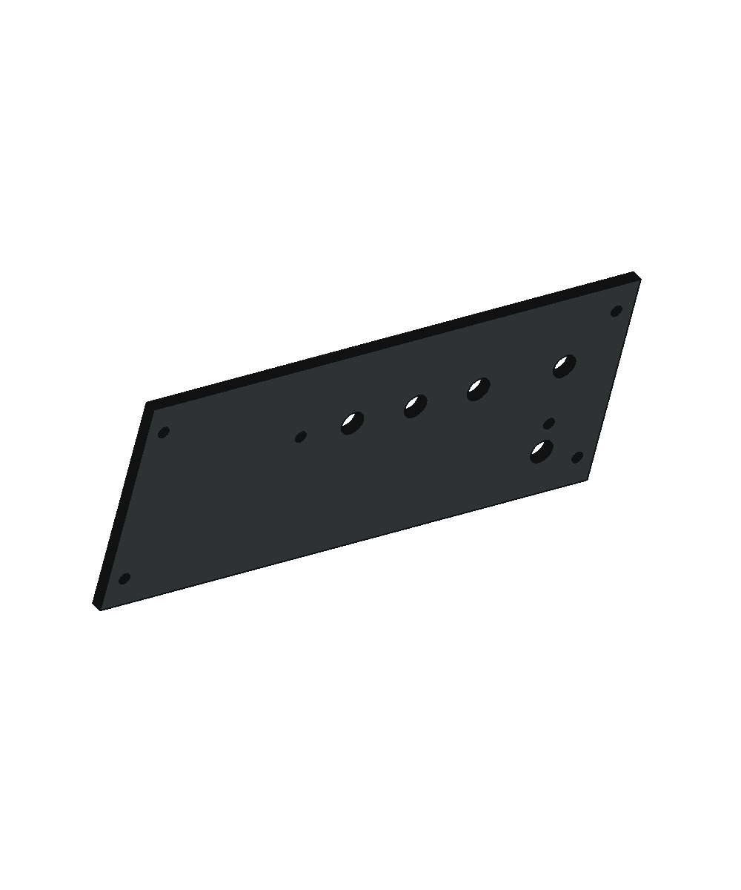

# 唱机 + 音响旋钮面板

本版旋钮面板为 **70 × 170 × 3.5 mm**，背面平整，原左右两条定位条已移除。白色文字、分隔线、三角标识和 Ariel LOGO 向正面凸起 **0.4 mm**，总打印厚度 **3.9 mm**。本版相较 65 × 165 mm 版本向右累计加宽 5 mm、向下延长 5 mm；右列固定孔累计右移 5 mm，底排下移 5 mm，耳机孔左移 1.2 mm。其余功能孔与标识保持正面坐标。此版尚未打印试装。

黑色底板与白色标识是两组可独立指定颜色的几何，白字直接接触完整的 3.5 mm 底板，底板不再挖文字凹槽。功能字使用 Noto Sans Bold，Ariel 使用 Sigmar One；A/R 字腔保持开放。





## 孔位与标识

正面左上角为原点，X 向右、Y 向下，单位 mm。所有孔为直孔，无沉头或孔径补偿。

| 功能 | X | Y | 孔径 |
|---|---:|---:|---:|
| 唱机耳机输出 | 15.3 | 20 | 7.5 |
| 唱机电源 LED | 25 | 20 | 3.5 |
| 唱机旋钮 | 45 | 20 | 7.5 |
| VOLUME | 45 | 50 | 7.5 |
| TREBLE | 45 | 72 | 7.5 |
| BASS | 45 | 94 | 7.5 |
| 音响电源 LED | 45 | 112 | 3.5 |
| 左上固定 | 9.5 | 6 | 3.5 |
| 右上固定 | 60.5 | 6 | 3.5 |
| 左下固定 | 9.5 | 164 | 3.5 |
| 右下固定 | 60.5 | 164 | 3.5 |

全部功能字、LOGO、三角标识与分隔线可以分色打印。顶排 PHONES 中心 X=13，POWER 中心 X=28.5，CONTROL 中心 X=45，基线 Y=12.5，字高 2.6 mm；保留原有文字间距。PHONO 中心 X=32.5、字高 3 mm，AMPLIFIER 字高 2.8 mm。音响标识字高 3.2 mm，基线 Y=51.6、73.6、95.6、113.6；分隔线 X=10、Y=32、长 45、宽 0.6 mm。Ariel 宽 42 mm，中心 **(32.5,139)**，范围约 **X=11.5–53.5、Y=134.51–143.49 mm**。参数与字体源见 [几何参数](../../../cad/control-panel.json)。

三个音响旋钮右侧各设一条左细右粗的白色三角标识，表示左旋调小、右旋调大。范围 X=55～66，长度 11 mm，右端高 3 mm，中心 Y=50 / 72 / 94；凸起 0.4 mm，与白字同一可分色零件。相对 Ø14 旋钮帽，横向净距 3 mm，距右边缘 4 mm。

Ø14 旋钮帽与 Ø7 螺丝头仅为预览投影，不包含在打印件中。

## 文件与打印

- **[0.2 mm 喷嘴 Bambu Studio 项目](Control-panel-bambu-0.2mm.3mf)**：P2S 0.2 mm，层高 0.10 mm、首层 0.10 mm、Arachne、顶部实心厚度 0.8 mm / 8 层、单调线顶面、顶面速度 30 mm/s，关闭支撑和熨烫。背面已在热床上，正面凸字朝上；黑底耗材 1、白字耗材 2，两个零件共同定位。几何逐顶点、逐三角形与本版 STL 一致。
- **[0.4 mm 喷嘴项目](Control-panel-bambu.3mf)**：同步相同新几何和方向，保留 P2S 0.4 mm / 0.20 mm，顶层厚度 0.8 mm / 4 层；本次试切片针对 0.2 mm 项目。
- `tools/update_control_panel_bambu.py`（FreeCAD Python）同步两个网格与上述表面参数，保留现有打印机、耗材、温度及机器 G-code 配置，将擦料塔 X 移至 180 mm 避免新外廓与塔裙边冲突，并清除旧切片缓存和缩略图。只适用于当前两个零件、平移变换的项目。
- [黑色底件 STL](Control-panel.stl)：一个闭合连通网格，含 11 个通孔、平整背面，外廓 **70 × 170 × 3.5 mm**。
- [白色文字／LOGO STL](Control-panel-markings.stl)：62 个闭合字形／线条／三角标识分量，与底件共用坐标，打印 Z=3.5～3.9 mm。必须作为黑底的第二个零件导入，保留高度；不要将字件单独落到热床。
- [通用分色 3MF](Control-panel-color.3mf)：包含同一父对象下的黑白两个零件，无打印机配置。
- [FCStd](Control-panel.FCStd)、[STEP](Control-panel.step)：黑色底板与白色标识两组几何，共 63 个实体；FCStd 保存颜色与可见性。
- [1:1 面板孔轮廓](Control-panel-outline.svg)：外边界与 11 个面板孔，不是木板窗口模板。
- **[A4 木板开孔纸样](../../pdf/control-panel-cutting-template-A4.pdf)**、[纸样检查记录](../../pdf/control-panel-cutting-template-A4.json)：打印“实际大小 / 100%”，关闭“适合页面”，先核对 100 mm 标尺和 50 × 50 mm 方框。实线为木板窗口，虚线为面板定位外廓，十字为木板导孔中心；导孔直径按螺丝牙型和木材另定。
- [参数与哈希报告](Control-panel.json)、[Bambu 检查记录](Control-panel-bambu-check.json)。
- [固定示意图](../../../previews/control-panel-mounting-concept.html)。

**背面贴热床、正面朝上；单位 mm，100% 比例，无需结构支撑。** CAD 与 STL 共用 X=x、Y=170−y、Z 坐标；黑底 Z=0～3.5，白字 Z=3.5～3.9，未镜像。先打印黑色底板，再打印顶部白字；0.10 mm 层高下白字占顶部四层。

从 STL 导入时，同时选择两份 STL，并使用“作为一个包含多个零件的对象”；不要单独重新居中。只导入底件 STL 没有独立白色文字。打开原生项目后，在“准备 → 对象”展开父对象，在两个零件的“耗材丝”编号格分别选色。不要在父对象上统一换色。切片建议使用 Arachne，实际打印前核对细字路径。

## 木板窗口与固定

10 mm 木板窗口保持 **59.4 × 136 mm**，从 **(2.8,12)** 到 **(62.2,148)**；左搭边 2.8 mm、右搭边 7.8 mm，上固定木条 12 mm、下固定木条 22 mm。背面两条定位条已经移除；面板由四个正面螺丝夹紧，安装时按孔位定位。叠放底板同步下延和右侧加宽；左侧上下长条向左延至 X=-65，Y 坐标保持，底板下方开口已扩至 X=2.8～62.2、Y=158，底部实心横边高 12 mm，孔中心上下各留 6 mm；木板窗口保持原尺寸。

PCB 与面板成 90°、向箱体内部延伸。唱机耳机中心到 PCB 左缘 10 mm 已记录。音响 LED 中心 Y=112，其 PCB 底部在其下方 45 mm，故下缘参考 Y=157，距面板底边 13 mm。窗口下边仍为 Y=148，与 PCB 下缘有 **9 mm 投影重叠**；本次外廓调整不改变窗口与 PCB 的纵向关系，实际深度和元件空间仍需试装核对。

螺杆 Ø3.2、头径 Ø7；面板固定孔 Ø3.5，单边间隙 0.15 mm。固定孔 X=9.5/60.5、Y=6/164。木板导孔、螺丝长度与握钉强度另定，Ø3.5 不是木板导孔规格。

## 重新生成与验证

在 FreeCAD 1.1.1 GUI 执行 [build-control-panel.FCMacro](../../../tools/build-control-panel.FCMacro)，先关闭目标，手工修改需另存。只更新独立面板，不修改主装配。

```sh
open -a FreeCAD --args "$PWD/tools/build-control-panel.FCMacro"
```

在含 ReportLab 的 Python 中执行 `tools/control_panel_template.py --font "$PDF_FONT"` 重建纸样，`PDF_FONT` 指向可嵌入的中文 TrueType 字体。字体路径为本机运行参数。

```sh
rsvg-convert previews/control-panel.svg -o previews/control-panel.png
PYTHONPATH="${FREECAD_RESOURCES:?请先设置 FreeCAD 运行环境}/lib" \
  "$FREECAD_RESOURCES/bin/python" -m unittest discover -s tests -p 'test_control_panel.py' -v
git diff --check
```

生成器输出 CAD、STEP、STL、通用 3MF、报告与主预览。原生 Bambu 项目使用更新脚本同步当前 STL，随后重新切片；旧切片预览不作为本版打印依据。外观参数在 [颜色参数](../../../cad/control-panel-appearance.json)，STL 不保存颜色。

本版 18 项检查通过，覆盖面板 10 项、底板 7 项和两个原生项目 1 项。检查包括平整背面、孔位、贯穿深度、0.4 mm 凸字、每个字形与底板接触、A/R 字腔、保存的 CAD/STEP、STL 拓扑、黑白分件、原生项目坐标与表面参数。静态检查不保证实物平整度、细字完整性或 PCB 配合。

0.2 mm 命令行试切片成功生成 39 层：黑色第 1～35 层、白色第 36～39 层。顶部四层每层的 62 个标识区域均存在白色路径；擦料塔与模型的路径冲突检查通过，预估总用时约 4 小时 10 分钟、耗材约 27.04 g，仅为本配置估算。2026-10-10 已在 Bambu Studio 中完成当前 0.2 mm 项目的 GUI 切片及第 35、36、39 层预览检查：黑色顶面路径连续，文字、LOGO 和三角标识均可见；孔圈的小白点随“缝”显示开关消失，是接缝位置标记。关闭显示不代表取消实体接缝。GUI 本次估算约 3 小时 47 分钟、26.86 g，与命令行估算分开记录；未调整打印参数。试切片与路径检查见 `Control-panel-bambu-0.2mm-check.json`；交付项目保留可编辑模型和参数，不包含 G-code。原打印机结束代码中的 `T65535` 在本机命令行分析器中产生诊断，机器代码保持原配置；实际打印请在 Bambu Studio 中重新切片并核对设备、耗材及预览。
