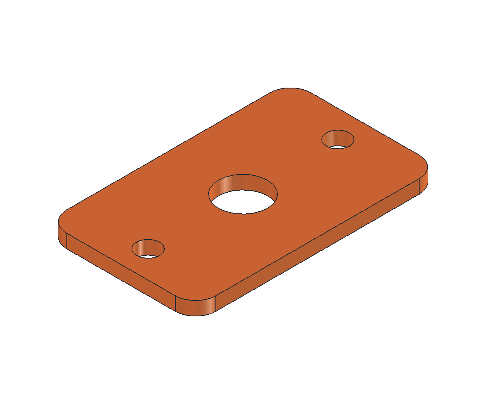
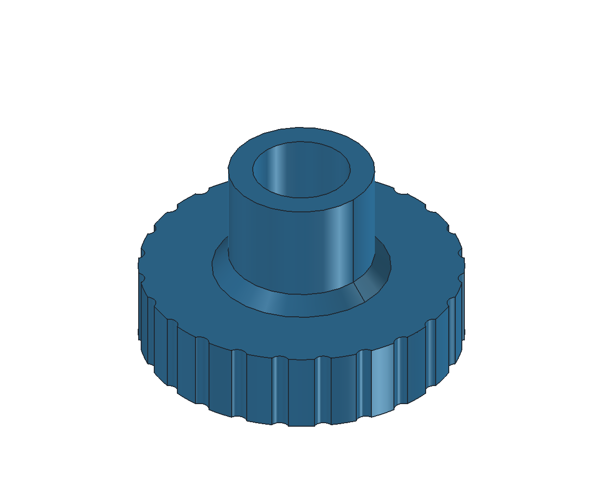
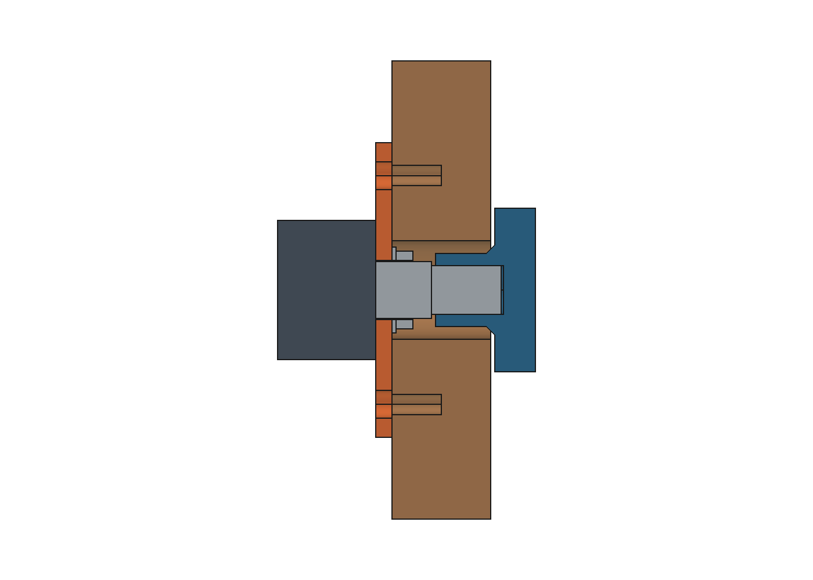

# 灯带电位器固定平板与定制旋钮 · 独立试装

平板从背板内侧用上下两颗螺钉固定，电位器用原螺母夹紧平板。定制旋钮通过内伸轴套进入木孔、连接短轴。**背板仅需 Ø12 mm 前后同径圆通孔，不做沉台、阶梯孔或局部铣薄。** 本目录只交付独立打印件，不修改主装配、主 STEP、背板或整机零件表。

## 两个独立模型

| 零件 | CAD / 交换格式 / 打印格式 | 当前外廓 |
|---|---|---|
| 固定平板 | [FCStd](LED-pot-plate.FCStd) / [STEP](LED-pot-plate.step) / [STL](LED-pot-plate.stl) | 22 × 36 × 2 mm |
| 内伸轴套旋钮 | [FCStd](LED-pot-knob.FCStd) / [STEP](LED-pot-knob.step) / [STL](LED-pot-knob.stl) | Ø20 × 总高 12.2 mm；装机后凸出 5.5 mm |

每个模型各含一个可见有效实体，数量各一件；不是把两个零件放进同一个 STL。







半剖面中棕色为 12 mm 木板，橙色为平板，蓝色为定制旋钮，深灰为电位器占位，浅灰为安装套、轴、垫圈和螺母。木板和采购件为临时夹具，不保存进两个模型。电位器本体、引脚和 PCB 外形尚未实测。

[参数、派生尺寸、验证及哈希](LED-pot-controls.json)

## 已知尺寸与试设尺寸

| 项目 | 当前值 | 状态 |
|---|---:|---|
| 螺纹段长度 | 6.8 mm | 用户实测 |
| 螺纹顶端至轴尖 | 8.5 mm | 用户实测；本体至轴尖合计 15.3 mm |
| 螺母厚 / 最大外径 | 2 / 11 mm | 用户实测，11 不是六角对边尺寸 |
| 背板圆通孔 | Ø12 mm，前后同径 | 用户指定 |
| 背板厚度 | 12 mm | 当前主模型，实物待核对 |
| 固定平板 | 22 × 36 × 2 mm，R3 外角 | 可调试设，无凸台或背面凹口 |
| 平板固定孔 | 上下 2 × Ø3.4 mm，孔距 28 mm | 可调试设 |
| 内侧木螺钉盲预孔 | Ø2.5 × 深 6 mm | 可调试设，保留 6 mm 木厚，不规定螺钉总长 |
| 平板电位器安装孔 | Ø7.2 mm | 螺纹直径暂按 Ø7；待实测，不能按螺母 Ø11 开孔 |
| 垫圈外径 / 厚度 | 10.5 / 0.5 mm | 待实测；必须小于 Ø12 木孔，不沿用旧版未确认的 Ø12 垫圈 |
| 电位器本体 | Ø17 × 12 mm 圆柱占位 | 待实测，未确认是否带 PCB |
| 旋钮圆盘 | Ø20 × 厚 5 mm，24 道浅防滑槽 | 可调试设，替代原装旋钮 |
| 圆盘背面至木板 | 0.5 mm | 可调试设 |
| 内伸轴套 | 外径 Ø9、长 7.2 mm | 高度链生成；进入木板约 6.7 mm |
| 轴套根部加强 | 最大 Ø11，锥形过渡高 1 mm | 可调试设，进入木孔的部分仍有径向间隙 |
| 套轴长度 / 轴尖间隙 | 8 / 0.3 mm | 可调试设 |
| 轴外径 / 轴形 | Ø5.8–5.9 mm / 花轴 | 用户实测和确认；包络检查取 Ø5.9 mm |
| 旋钮轴孔 | Ø6 mm 圆形试配孔 | 直径间隙 0.1–0.2 mm，未建匹配齿形 |
| 花轴齿数 / 齿根直径 / 齿形 | 待测参数，暂为空 | 实测后再建立匹配轴孔 |
| 轴套端部至螺纹顶端 | 0.5 mm | 条件计算 |
| 安装后总后凸 | 5.5 mm | 圆盘厚 5 mm + 木板间隙 0.5 mm |

平板安装孔用螺母夹紧，木板 Ø12 孔只避让螺母和旋钮轴套。原螺母先在内侧平板上装好，再固定平板，最后从背板外侧装旋钮。旋钮轴套不应碰螺纹顶端，圆盘背面不应摩擦木板。

**已确认是外径 5.8–5.9 mm 的花轴，齿形尚未测量。** 当前采用 Ø5.9 mm 圆柱包络做避让检查，旋钮保留 Ø6 mm 圆形试配孔；名义直径间隙 0.1–0.2 mm，单边 0.05–0.1 mm。圆孔没有匹配齿形，不能证明咬合传扭或抗松脱；打印后小孔也可能收缩。`potentiometer.shaft_spline` 中的齿数、齿根直径和齿形暂为空，实测后再建立匹配孔。不要把当前圆孔版当成已完成的花轴连接。D 轴参数化功能仍保留，可设 `shaft_profile=d` 并调整平边深度及间隙。

30 mm 可用净宽内，22 mm 平板居中时两侧各留 4 mm。最终开孔中心 X 未定，Z=88.5 仅保留与插口等高的建议；可用高度、PCB、焊点、线束和拧螺钉空间仍需核对。走线避开 AC 端子。平板和轴孔的实际密封未验证。

## 参数和重新生成

源参数：[cad/led-pot-mount.json](../../../cad/led-pot-mount.json)。`confirmed_fields` 标出电位器实测或确认字段；`shaft_diameter_mm` 采用实测上限 5.9 mm 作为包络值，`user_requested_fields` 标出背板孔径要求，其余尺寸继续可调。旋钮轴套长度和盲孔深度随板厚、平板厚度、圆盘间隙与套轴长度联动生成，不单独硬编码。

平板止转凸耳孔默认关闭，实物有凸耳时可在 `anti_rotation` 中调整并开启。`plate.seal_thickness_mm` 是密封垫压紧后的厚度，默认不计垫片。

两个 FCStd 各保存单个静态 `Part::Feature` 和只读参数快照。**改 JSON 后需重新运行宏，模型不随属性编辑自动重算。** 使用 FreeCAD 1.1.1 GUI 执行 [build-led-pot-mount.FCMacro](../../../tools/build-led-pot-mount.FCMacro)，先关闭两个目标文件，需保留的手动编辑先另存。宏不保存其他打开文档。

FreeCAD 尚未启动时，从仓库根目录可运行：

```sh
open -a FreeCAD --args "$PWD/tools/build-led-pot-mount.FCMacro"
```

生成器：[tools/build_led_pot_mount.py](../../../tools/build_led_pot_mount.py)。宏生成各自的 FCStd / STEP / STL、预览和验证 JSON，然后重开两个独立模型。按需调用生成器的 `package()` 生成 ZIP；仓库只保存独立文件。

## 打印与验证边界

- STL 单位 mm，按 100% 导入。
- 平板整面 Z=0 贴床，孔轴朝上。
- 旋钮正面 Z=0 贴床，内伸轴套和盲孔口朝上；不要翻成轴套尖端贴床。
- 当前几何两件均按无需支撑设计，轴孔沿打印方向向上开口；仍需在切片中核对小孔、套壁、防滑槽和首层。
- 先在边角料上加工同径 Ø12 孔试装。打印收缩、轴形匹配、旋钮传扭、固定强度、密封和实物装配未验证。

专用检查命令，FreeCAD 环境变量按仓库 README 设置：

```sh
PYTHONPATH="${FREECAD_RESOURCES:?请先设置 FreeCAD 运行环境}/lib" \
  "$FREECAD_RESOURCES/bin/python" -m unittest discover -s tests -p 'test_led_pot_mount.py' -v
```

测试覆盖纯平板、盲轴孔和打印姿态、前后同径 Ø12 木孔、最大外径 Ø11 螺母净空、实测轴径范围及试配间隙、尺寸联动、D 轴安装变换、无效参数拒绝、两个模型分别回读和可见性、主模型文件未改动。验证 JSON 记录各自的 FCStd / STEP 一致性和 STL 单实体闭合网格检查；不会据此宣称已经验证了真实轴配合或传扭能力。
